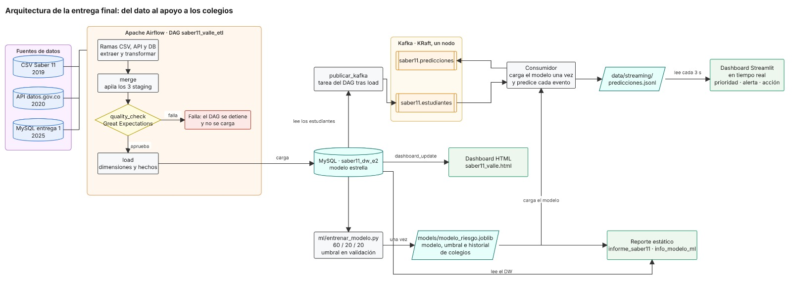
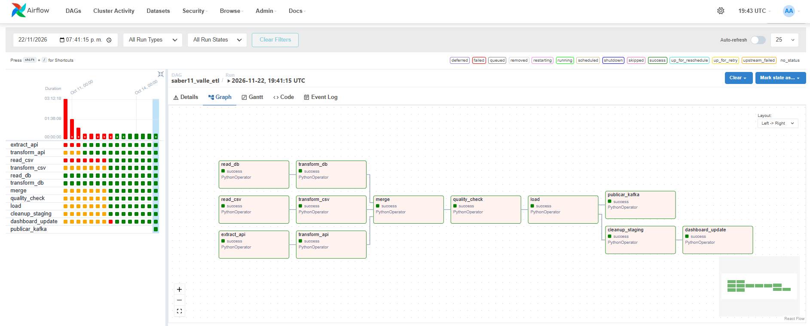
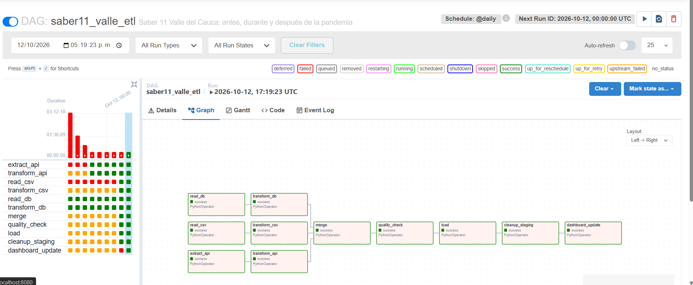
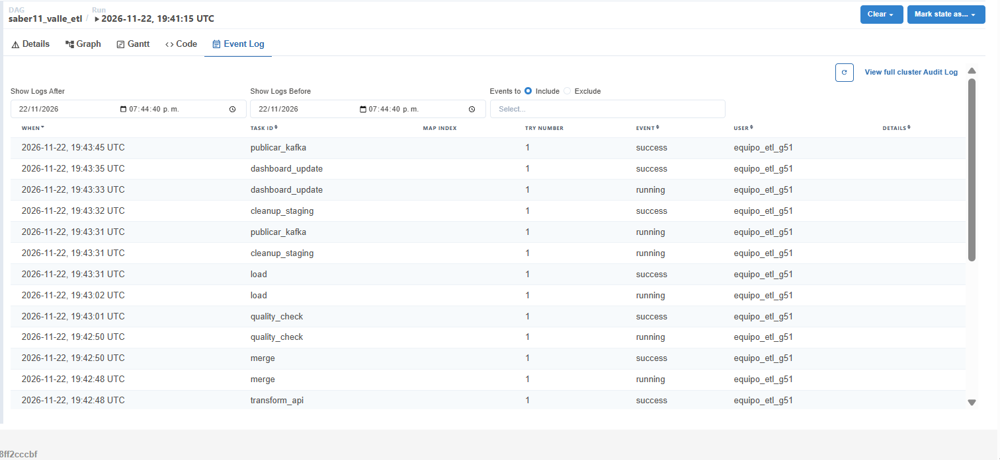
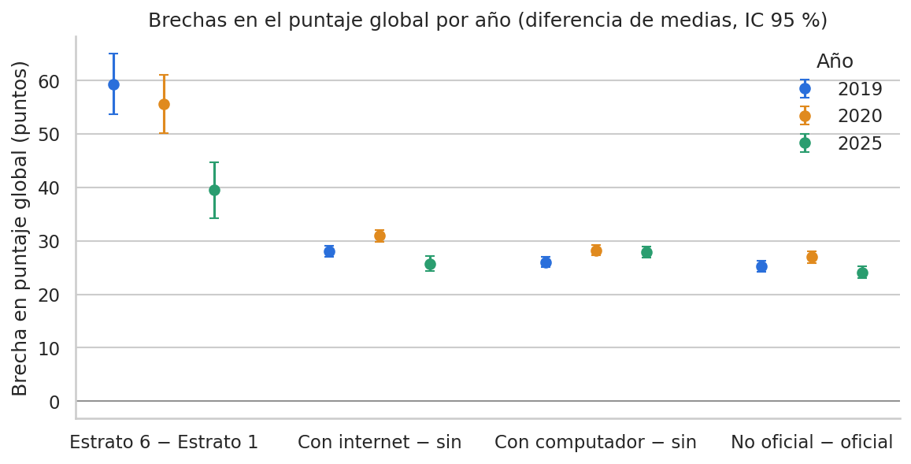
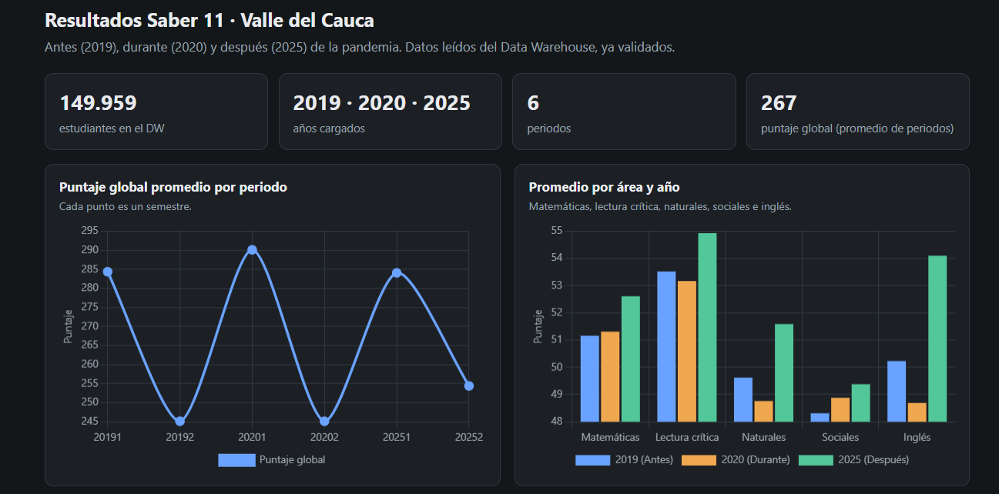
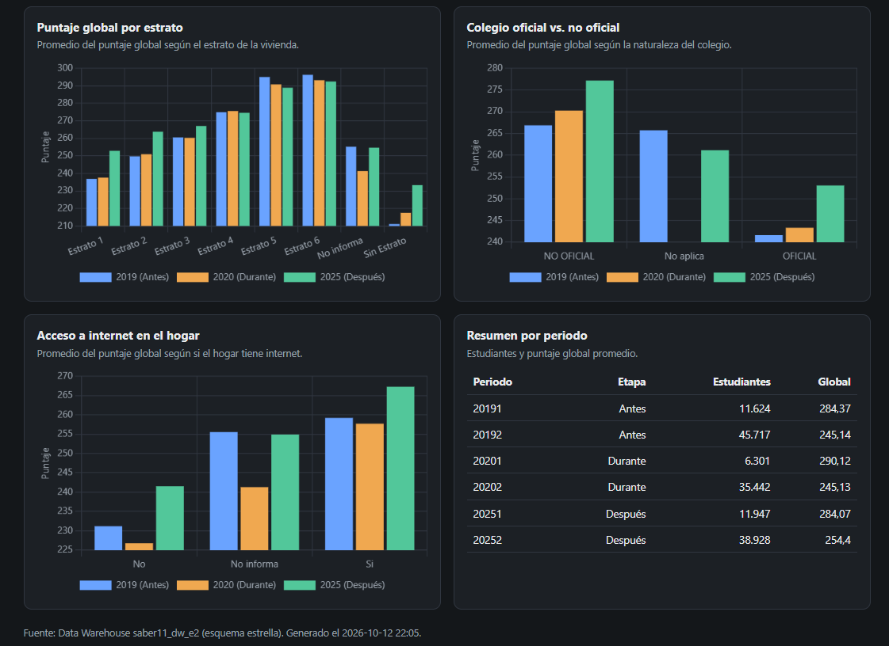
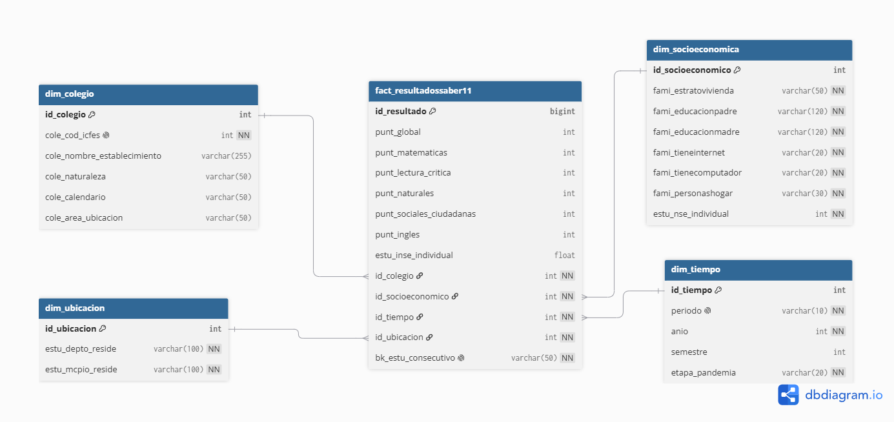

# ETL Saber 11 — Valle del Cauca antes, durante y después de la pandemia (Entrega Final)

Pipeline ETL reproducible sobre los resultados Saber 11 del Valle del Cauca (2019, 2020 y 2025) que alimenta **dos formas de consumo a partir de una sola arquitectura**: una **analítica** (modelo dimensional en estrella + reporte estático con pruebas de hipótesis) y una **operativa** (un modelo de ML servido en tiempo real por Kafka y mostrado en un dashboard para decidir a qué colegios y municipios priorizar apoyo). La articulación de valor de ambas está en la sección 12.

## 1. Objetivo
¿Cómo cambió el rendimiento en Saber 11 y su relación con las condiciones socioeconómicas del hogar (estrato, educación de los padres, internet y computador, NSE) entre 2019 (antes), 2020 (durante) y 2025 (después de la pandemia) en el Valle del Cauca?

**Propósito del pipeline.** Automatizar de forma reproducible la extracción, transformación, validación y carga de los resultados de Saber 11 en el Valle del Cauca para tres momentos (2019, 2020 y 2025), de modo que las tres fuentes queden unificadas en un solo modelo de datos y las comparaciones entre periodos se hagan siempre sobre datos validados.

**Insights que debe entregar.**
- Cómo cambió el puntaje global y el de cada prueba entre antes (2019), durante (2020) y después (2025) de la pandemia.
- Cómo se relaciona el rendimiento con el estrato, la educación de los padres, el acceso a internet y computador, y el nivel socioeconómico (NSE) del estudiante.
- Si esas diferencias socioeconómicas se mantuvieron, aumentaron o disminuyeron después de la pandemia.

**Alcance del análisis formal.** Las pruebas formales y la brecha por año cubren estrato, internet, computador y tipo de colegio; la educación de los padres y el NSE se analizan de forma descriptiva (sección 7).

## 2. Arquitectura



*Figura 1. Arquitectura de la entrega final: del dato a la decisión. Tres fuentes (CSV 2019, API 2020 y base SQL 2025) entran a un DAG de Airflow que extrae, transforma, valida con Great Expectations y carga un DW en estrella en MySQL. Desde ahí nacen los dos caminos: el **analítico** (reporte estático e informe, sección 7) y el **operativo** (productor → Kafka → consumidor con el modelo → dashboard en tiempo real, secciones 9–11). El diagrama de la entrega 2 (solo ETL) sigue en `docs/arquitectura.png` / `docs/arquitectura.svg`.*

Tres ramas en paralelo producen archivos con la misma estructura (ver sección 4.1), que se apilan, se validan con Great Expectations y se cargan en un modelo estrella en MySQL. Sobre ese modelo se construyen los dos consumos:

- **Analítico (punto en el tiempo):** el modelo dimensional alimenta el reporte estático y el informe de pruebas de hipótesis (sección 7). Responde *cómo cambió la brecha socioeconómica antes/durante/después de la pandemia*.
- **Operativo (en tiempo real):** un modelo de ML entrenado sobre el DW (sección 9) se publica por Kafka (sección 10) y se consume en un dashboard que prioriza colegios y municipios (sección 11). Responde *a qué colegios priorizar apoyo ahora*.

| Rama | Fuente | Año |
|---|---|---|
| CSV | Resultados Saber 11 | 2019 |
| API | datos.gov.co, Saber 11 | 2020 |
| DB | Base de la entrega 1 | 2025 |

## 3. Pasos del pipeline y diseño del DAG.
DAG `saber11_valle_etl` (`dags/saber11_etl_dag.py`):

```
extract_api -> transform_api ┐                                   ┌-> cleanup_staging -> dashboard_update
read_csv    -> transform_csv ├-> merge -> quality_check -> load --┤
read_db     -> transform_db  ┘                                   └-> publicar_kafka
```


*Figura 2. Vista Graph del DAG en Airflow: tres ramas en paralelo convergen en `merge`; tras `load` el flujo se abre en `cleanup_staging → dashboard_update` (analítico) y en `publicar_kafka` (operativo).*



*Figura 3. Ejecución exitosa de la corrida completa del pipeline en Airflow (todas las tareas en estado success).*



*Figura 4. Event Log de Airflow: cada tarea pasa a `success`, incluida `publicar_kafka` al final.*

| Tarea | Entrada → salida | Reintentos |
|---|---|---|
| extract_api | API → raw_api.parquet | 3 (5 min, progresivo) |
| transform_api | raw_api → staging_api | 0 |
| read_csv | CSV 2019 → raw_csv.parquet | 1 |
| transform_csv | raw_csv → staging_csv | 0 |
| read_db | MySQL raw_saber11 → raw_db.parquet | 2 (30 s) |
| transform_db | raw_db → staging_db | 0 |
| merge | 3 staging → staging_merged | 0 |
| quality_check | staging_merged → aprueba o falla | 0 |
| load | staging_merged → DW | 0 |
| cleanup_staging | borra temporales (solo si load terminó bien) | 0 |
| dashboard_update | DW → tablero analítico HTML | 0 |
| publicar_kafka | DW → tópico `saber11.estudiantes` (reusa el productor; 200 eventos por defecto) | 2 (30 s) |

Tras `load`, el flujo se abre en dos: `cleanup_staging → dashboard_update` (camino analítico) y `publicar_kafka` (camino operativo). El detalle de la parte de streaming está en las secciones 10 y 11.

Parámetros: `@daily` técnico (los datos son históricos: la ejecución diaria cumple la consigna de extracción programada, pero en la práctica no cambia nada), `catchup=False`, `max_active_runs=1`, reintento global 0. Los datos pasan entre tareas por archivos parquet en `data/staging`, nunca por XCom.

## 4. Decisiones de transformación.

### 4.1. Estructura común del dataset unificado

Las tres fuentes se llevan a las mismas 25 columnas, en este orden y con estos tipos, antes de apilarlas. Esta estructura está definida en `etl/esquema.py` y `validar_esquema()` la verifica en cada rama y en el *merge*.

| Grupo | Columna | Tipo | Regla |
| :--- | :--- | :--- | :--- |
| **Identificación** | `estu_consecutivo` | Texto | Nunca nulo, sin duplicados. |
| | `periodo` | Texto | Formato `AAAAS` (ej. `20191`), nunca nulo. |
| | `anio` | Entero | Primeros 4 dígitos de `periodo`. |
| | `semestre` | Entero | Último dígito de `periodo`. |
| **Ubicación** | `estu_depto_reside`, `estu_mcpio_reside` | Texto | Residencia del estudiante. |
| **Colegio** | `cole_codigo_icfes` | Entero | `-1` = inscripción individual (se renombra a `cole_cod_icfes` en la Fact). |
| | `cole_nombre_establecimiento`, `cole_naturaleza`, `cole_calendario`, `cole_area_ubicacion` | Texto | Información del establecimiento educativo. |
| **Socioeconómicas** | `fami_estratovivienda`, `fami_educacionpadre`, `fami_educacionmadre`, `fami_tieneinternet`, `fami_tienecomputador`, `fami_personashogar` | Texto | Variables de entorno socioeconómico. |
| | `estu_nse_individual` | Entero | `1` a `4`; `-1` si falta. |
| | `estu_inse_individual` | Decimal | Nulo si falta. |
| **Resultados** | `punt_global` | Entero | `0` a `500`, puede ser nulo. |
| | `punt_matematicas`, `punt_lectura_critica`, `punt_c_naturales`, `punt_sociales_ciudadanas`, `punt_ingles` | Entero | `0` a `100`, pueden ser nulos (se renombra `punt_c_naturales` a `punt_naturales` en la Fact). |

**Filtros:** Solo Valle del Cauca (comparando `UPPER(TRIM(estu_depto_reside))`) y solo los periodos del año de cada fuente, aplicados al leer. Si una fuente no trae una columna (por ejemplo NSE/INSE en el subconjunto `20201`), se crea en nulo; no se inventan valores.

### 4.2. Limpieza compartida (`etl/limpieza.py`)
Es la limpieza de la entrega 1 convertida en una sola función, `limpiar()`, que las tres ramas usan como último paso:
- Texto: repara caracteres corruptos con ftfy, quita espacios y escribe los faltantes como `No informa`. Valores como `nan`, `None` o `NULL` escritos como texto se tratan como faltantes.
- Homologación de etiquetas: el área del colegio llega como `URBANO` o `URBANA` según la fuente y se unifica a `URBANA` (`EQUIVALENCIAS` en `etl/esquema.py`).
- Estudiantes sin colegio: código `-1`, nombre `Sin colegio (inscripción individual)` y `No aplica` en naturaleza, calendario y área.
- NSE faltante = `-1`; INSE faltante = nulo.
- Deduplicación por `estu_consecutivo`, priorizando el registro con colegio sobre la inscripción individual.
- Los renombres `punt_c_naturales → punt_naturales` y `cole_codigo_icfes → cole_cod_icfes` se hacen al cargar al DW.

### 4.3. Diferencias con la entrega 1
- Un mismo estudiante en dos colegios distintos, un periodo que no sea AAAAS o un puntaje con decimales detienen el proceso con un error claro (antes solo era un aviso o pasaban sin revisar).
- Las filas que no encuentran su llave en una dimensión también detienen la carga (antes se descartaban).
- DW nuevo (`saber11_dw_e2`) separado del nacional de la entrega 1, con `COLLATE utf8mb4_bin` para que "Si"/"Sí" o "VALLE"/"Valle" no se mezclen al cargar dimensiones, y `dim_tiempo.etapa_pandemia` (Antes / Durante / Después).

### 4.4. Resultados de la rama DB (2025)
Ficha completa en `docs/ficha_fuente_db.md`. Las cifras de esta tabla corresponden a la rama DB **cargada sola** (solo 2025). Los totales del DW con los tres años (149.959 filas en la fact) están en la sección 8.

| Etapa | Resultado |
|---|---|
| Tabla `raw_saber11` (nacional, entrega 1) | 661.891 filas |
| Tras filtro Valle + 2025 (`read_db`) | 50.875 filas (20251: 11.947 · 20252: 38.928) |
| `staging_db.parquet` (`transform_db`) | 50.875 filas, 25 columnas |
| Fact en el DW tras `load` (solo 2025) | 50.875 filas |
| Dimensiones (solo 2025) | `dim_colegio` 1.267 · `dim_ubicacion` 42 · `dim_socioeconomica` 8.699 · `dim_tiempo` 2 |

Hallazgos: 7.856 estudiantes sin colegio (inscripción individual), 0 filas con llaves nulas, 0 duplicados y 0 dobles inscripciones; 376 colegios con atributos distintos entre registros (aviso informativo de la limpieza).

Pruebas realizadas:
- `pytest`: 9 pruebas de la limpieza, todas pasan.
- `read_db` y `transform_db` corren en local y dentro de Airflow (`airflow tasks test`).
- Repetibilidad: cada ejecución sobreescribe el staging (50.875 filas).
- Idempotencia de la carga: cargar dos veces el mismo staging deja 50.875 filas en la fact.
- Codificación: `etapa_pandemia` se guarda en UTF-8 ("Después").

### 4.5. Resultados de la rama CSV (2019)

Ficha técnica completa en `docs/ficha_fuente_csv.md`.  
**Fuente original:** `2019.csv` (Datos Abiertos ICFES Saber 11 2019, alcance nacional, 459,6 MB, 94 columnas). Es el mismo archivo que la sección 13 llama `saber11_2019.csv`: ese es el nombre con el que se guarda en `data/input/`.

| Etapa | Resultado |
|---|---|
| CSV completo (nacional) | 680.893 filas (20191: 66.104 · 20192: 614.789) |
| Tras filtro Valle + 2019 (`read_csv`) | 57.341 filas (20191: 11.624 · 20192: 45.717) |
| `staging_csv.parquet` (`transform_csv`) | 57.341 filas, 25 columnas |

#### Flujo de Transformaciones 

**`read_csv`** (`2019.csv` → `raw_csv.parquet`)
1. **Lectura por bloques:** Procesamiento en bloques de 100.000 filas para optimizar memoria (máximo 216 MB de uso, ~8 s).
2. **Detección de Encoding:** El archivo viene en `latin-1` (ISO-8859-1). `read_csv` intenta UTF-8 y aplica `latin-1` como fallback validado.
3. **Manejo de nulos y tipos:** Carga inicial como texto preservando cadenas nulas (`""`, `NA`, `N/A`, `null`, `NULL`).
4. **Selección de columnas:** Filtrado estricto de las 23 columnas de entrada requeridas por el contrato, descartando las 71 restantes.
5. **Filtro geográfico (Valle del Cauca):** Normalización y filtrado sobre `UPPER(TRIM(estu_depto_reside)) = 'VALLE'`, conservando 57.341 registros (8,4 % del total nacional).
6. **Filtro de periodo:** Confirmación de periodos pertenecientes a 2019 (`20191` y `20192`).
7. **Escritura raw:** Generación de `raw_csv.parquet` (57.341 filas x 23 columnas de texto).

**`transform_csv`** (`raw_csv.parquet` → `staging_csv.parquet`)
8. **Completitud de columnas:** Creación en nulo de variables faltantes en el origen.
9. **Limpieza compartida (`limpiar(df, fuente="csv_2019")`):**
   - *Inscripciones individuales:* 10.784 estudiantes asignados a código `-1`.
   - *Estandarización de texto:* Corrección de espacios y estandarización de faltantes a `"No informa"`.
   - *Tipos numéricos:* Conversión de puntajes a entero, INSE a decimal (12.899 nulos) y NSE a entero (`-1` si falta).
   - *Descomposición temporal:* Asignación de `anio = 2019` y `semestre` (1: 11.624 filas; 2: 45.717 filas).
10. **Escritura staging:** Generación de `staging_csv.parquet` (57.341 filas x 25 columnas unificadas).

#### Hallazgos Clave
- **Datos socioeconómicos en inscritos individuales:** Únicamente 5 de los 10.784 inscritos individuales diligenciaron datos socioeconómicos. Entre la población escolarizada, la ausencia de estrato fue de solo 8,2 %.
- **Validación de puntajes:** Todos los puntajes están dentro del rango válido (0–100 / 0–500). El puntaje global coincide con la fórmula ponderada oficial del ICFES en las 57.189 filas que cuentan con las cinco pruebas completas.
- **Composición por semestre:**
  - `20191` (Calendario B): El 99,7 % de los escolarizados (7.462 de 7.484) pertenecen a colegios No Oficiales (privados), alcanzando un puntaje global medio de 284,4.
  - `20192` (Calendario A): El 78,8 % de los escolarizados (30.774 de 39.073) pertenecen a colegios Oficiales (públicos), con un promedio global de 245,1.

#### Pruebas y Validación
- 5 pruebas unitarias automatizadas en `tests/test_rama_csv.py` (cobertura de filtros, lectura multi-archivo, variables de entorno, manejo de errores, esquema y repetibilidad).
- Repetibilidad e idempotencia confirmadas: ejecuciones sucesivas producen exactamente el mismo staging de 57.341 filas.

### 4.6. Supuestos y archivos que no se versionan
- **Periodo `20204`:** se trata como el segundo semestre de 2020 (35.442 filas de Valle); ver sección 5.
- **Inscripción individual:** la API de 2020 no trae estudiantes sin colegio; por eso `No aplica` en naturaleza, calendario y área no aparece en 2020.
- **NSE/INSE:** no se imputan; quedan como `-1` y nulo. No entran a las pruebas de hipótesis (solo al EDA, de forma descriptiva); su cobertura por año está en 7.1.
- **Puntajes comparables:** se asume que 2019, 2020 y 2025 usan la misma escala (0–500 global, 0–100 por prueba).
- **Datos históricos:** `@daily` es técnico; ejecutar de nuevo no cambia los datos.
- **`.gitignore`:** no se suben `.env` (credenciales), `data/` (CSV de entrada y staging), `dumps/` (volcado de `raw_saber11`), `logs/` ni el entorno virtual. El CSV de 2019 y el volcado se descargan del Drive del equipo (sección 13). Las limitaciones del análisis están en 7.3.

---

## 5. API

La rama API trae Saber 11 de 2020 desde datos.gov.co, la plataforma de datos abiertos del Estado. Esta plataforma publica cada conjunto en una dirección con forma **`https://www.datos.gov.co/resource/<id>.json`**, y permite pedir solo las filas que se necesitan en lugar de bajar el archivo completo.

El año 2020 está partido en dos publicaciones, una por periodo, y ninguna cubre sola el año:

| Conjunto | Periodo en la API | Filas del país | Filas de Valle |
|---|---|---|---|
| **a8xr-en99** | **20201** | 15.435 | 6.301 |
| **rnvb-vnyh** | **20204** | 504.872 | 35.442 |

Se usan las dos y se unen en **raw_api.parquet**.

**Por qué esta API**
Es la fuente oficial de los resultados de Saber 11 (ICFES) en datos abiertos, la misma de los otros dos años, y trae casi todas las columnas del esquema con el mismo nombre; solo hay que crear **`estu_nse_individual`** y **`estu_inse_individual`** en **a8xr-en99**. Además es el único origen que tenemos para 2020, deja filtrar Valle dentro de la consulta y funciona sin credenciales que es algo valioso cuando hacemos estos proyectos.

**Las consultas**
- El filtro de Valle **`upper(estu_depto_reside) = 'VALLE'`** se hace dentro de la consulta, para no descargar más de 500.000 filas del país.
- Se ordena por **`estu_consecutivo`** y se pagina de 10.000 en 10.000. Sin un orden fijo, las páginas se pueden repetir o saltar filas.
- Se usa la versión **`/resource/<id>.json`** porque funciona sin credenciales; la versión **/api/v3/views/...** pide autenticación.
- El token de aplicación **`SOCRATA_APP_TOKEN`** es opcional: sin token funciona, solo que más limitado; si se define, se envía en la cabecera **`X-App-Token`**.
- Ante errores temporales o límites de uso la descarga se reintenta sola y adicionalmente, la tarea **`extract_api`** del DAG tiene 3 reintentos con espera progresiva.

**Diferencias entre los dos conjuntos del ICFES**
- **a8xr-en99** no publica **`estu_nse_individual`** ni **`estu_inse_individual`**; se crean en nulo (NSE queda en **`-1`**).
- La API omite los campos nulos en el JSON, y por eso **`raw_api.parquet`** tiene columnas que algunos registros no traen. Solo se conservan las 23 columnas del esquema.

**Decisión sobre el periodo `20204`**
El conjunto del segundo semestre de 2020 publica el periodo como **`20204`**. La estructura de las tres ramas solo admite semestres 1 o 2, y ninguna de las dos publicaciones trae un **`20202`**, así que reasignarlo no pisa ni mezcla datos de otro periodo. La fuente no explica qué significa el 4; por eso decidimos tratar el **`20204`** como el segundo semestre de 2020 y reasignarlo a **`20202`**. El cambio se hace en **`transform_api`**, antes de la limpieza compartida, y **`raw_api.parquet`** conserva el valor original. La ficha de la fuente está en **`docs/ficha_fuente_api.md`**.

## 6. Great Expectations

La tarea **`quality_check`** revisa **`staging_merged.parquet`** con Great Expectations (usamos la versión 1.24.0, que es compatible con la imagen de Airflow del proyecto). Aquí se define un grupo de reglas y un Checkpoint que la ejecuta; si alguna regla falla, la tarea termina con error, **`load`** no corre y los archivos de staging se conservan para revisarlos. El resultado de cada ejecución queda en **`resultado_gx.json`**, dentro de la carpeta de staging.

| Qué revisamos | Regla | Por qué |
|---|---|---|
| Estructura | Existen las 25 columnas, en el orden del esquema | El merge y la carga dependen de la estructura común |
| Llaves | **`estu_consecutivo`** y **`periodo`** sin nulos; **`estu_consecutivo`** único | Es la llave de cada estudiante en la tabla de hechos |
| Tiempo | **`periodo`** con formato AAAAS, año 2019, 2020 o 2025 y semestre 1 o 2 | Cada fuente aporta un año; un periodo raro indica un error de la rama |
| Cobertura | Los tres años presentes, con un mínimo de filas por año | Detecta una carga cortada o una fuente que llegó vacía |
| Ubicación | **`estu_depto_reside`** empieza por VALLE | Solo estamos evaluando Valle del Cauca |
| Puntajes | **`punt_global`** entre 0 y 500; las otras cinco pruebas entre 0 y 100 | Fuera de ese rango el dato es imposible. Los nulos no cuentan |
| Socioeconómicas | NSE entre -1 y 4; internet y computador solo **`Si`**, **`No`** o **`No informa`** | Mantiene las categorías cerradas que usan las dimensiones |
| Colegio | **`cole_codigo_icfes`** mayor o igual a -1; **`cole_area_ubicacion`** solo **`URBANA`**, **`RURAL`** o **`No aplica`**; **`cole_calendario`** solo **`A`**, **`B`**, **`OTRO`** o **`No aplica`** | -1 es el código de inscripción individual; **`URBANO`** se homologa a **`URBANA`** en la limpieza compartida, y las categorías cerradas evitan que se creen dimensiones duplicadas |


**Mínimos de filas por año**
`MIN_FILAS_POR_ANIO` en `quality_check.py`:
- 2019: **50.000** filas VS el real es 57.341
- 2020: **40.000** filas VS el real es 41.743
- 2025: **45.000** filas VS el real es 50.875

Cada mínimo se fijó un poco por debajo del conteo real de su fuente, para detectar cargas incompletas sin que un descarte normal de duplicados dispare la regla de calidad.

**Integración y generación de informes analíticos**
Una vez que Great Expectations valida el archivo unificado `staging_merged.parquet`, los datos pasan a la tarea de carga en MySQL (`load`) y, después, a `dashboard_update` (tablero analítico HTML del DW) y a `publicar_kafka`, que abre el camino operativo en tiempo real (secciones 10–11). El EDA y el informe analítico con las pruebas estadísticas formales **no son tareas del DAG**: son cuadernos que se ejecutan en Docker sobre el Data Warehouse ya cargado (sección 13) y generan `reports/eda_saber11.html` y `reports/informe_saber11.html`.

## 7. Análisis Exploratorio de Datos (EDA) e Informe Analítico

Hay dos cuadernos en `notebooks/`. Ambos leen **solo el Data Warehouse** (`saber11_dw_e2`: 149.959 registros que ya pasaron Great Expectations y la carga) y se exportan a HTML en `reports/`. Ninguno es una tarea del DAG: se ejecutan a demanda cuando el DAG ya terminó (ver sección 13).

| Cuaderno | Salida | Para qué sirve |
|---|---|---|
| `eda_saber11.ipynb` | `reports/eda_saber11.html` | Calidad y forma de los datos: faltantes, duplicados, categorías, rangos, atípicos, distribuciones, relaciones y geografía. Justifica las decisiones de transformación (secciones 4 y 5). |
| `informe_saber11.ipynb` | `reports/informe_saber11.html` | Pruebas de hipótesis (ANOVA de Welch, t de Welch, *d* de Cohen, η², interacción año × grupo) para decir si las diferencias son significativas **y** de qué tamaño. |

Las funciones de apoyo (conexión al DW, pruebas estadísticas y gráficos) están en `notebooks/analisis_utils.py`. Todas las cifras del texto se calculan al ejecutar: si el DW cambia, los informes se actualizan solos.

**Cuadernos de entregas anteriores.** Como pide la consigna, en `notebooks/` se conserva el EDA de la **entrega 1** (`eda_entrega1.ipynb`, tomado del repositorio del equipo [ETL-project-icfes](https://github.com/LauMarinAlvis/ETL-project-icfes)). El EDA de la **entrega 2** evolucionó hasta el actual `eda_saber11.ipynb` (que ya lee el DW validado). Además, `notebooks/info_modelo_ml.ipynb` documenta el entrenamiento y la evaluación del modelo (sección 9).

**Alcance.** Las pruebas formales cubren año/etapa, estrato, internet, computador, naturaleza del colegio y áreas. La educación de los padres y el NSE/INSE se exploran solo de forma descriptiva en el EDA (distribución por año y correlación del puntaje global con el INSE, r = 0,40, y con el NSE, r = 0,36); no tienen prueba de hipótesis ni brecha por año.

### 7.1. Resumen del EDA
- **Volumen y carga:** 149.959 registros (57.341 en 2019; 41.743 en 2020; 50.875 en 2025). Las filas del DW coinciden con las esperadas en los tres años y hay 0 llaves de estudiante repetidas.
- **Rangos y atípicos:** 0 valores fuera de rango (global 0–500, áreas 0–100). Con la regla de Tukey, como máximo el 0,38 % del puntaje global de un año queda fuera de los límites y, en las áreas, como máximo el 3,54 % (Inglés 2020). No se eliminan: son resultados posibles.
- **Faltantes:** 9 de las 18 columnas revisadas tienen datos faltantes o «No informa». Los mayores porcentajes son estrato en 2025 (26,1 %), internet en 2025 (25,6 %) y estrato en 2019 (25,4 %). En 2020 son solo 4–5,5 %.
- **NSE/INSE:**
  - En **2019** faltan en 12.899 de los 57.341 registros (~22,5 %, asociados en su mayoría a inscripciones individuales).
  - En **2020**, el subconjunto `20201` no los publica desde la API, mientras que en `20202` (codificado como `20204`) sí están presentes con solo 1.490 faltantes (18,7 % en el año).
  - En **2025** faltan el 25,2 %.
  - En todos los casos los faltantes se rellenan con `-1` para NSE y nulo para INSE, sin imputar datos artificiales.
- **Consistencia de categorías:** las únicas categorías que no aparecen en los tres años son los `No aplica` de colegio (naturaleza, calendario y área), ausentes en 2020 porque la API no trae inscripciones individuales (ver sección 5).
- **Diferenciación de semestres:** el semestre 1 promedia 285,5 puntos y el semestre 2, 248,1. El calendario B es el 67,1 % del semestre 1 y el calendario A el 90,8 % del semestre 2: cada semestre reúne tipos de colegios distintos (entre quienes tienen colegio, en el semestre 1 casi todos son no oficiales y en el semestre 2 predominan los oficiales). Por eso el informe compara siempre dentro del mismo semestre.
- **Composición que cambia entre años:** los estratos 1 y 2 juntos son el 46,8 % de los estudiantes en 2019, el 61,4 % en 2020 y el 42,0 % en 2025; también cambian el acceso a internet y el tipo de colegio.
- **Relaciones:** el puntaje global se asocia más con Ciencias naturales (r = 0,92) y menos con Inglés (r = 0,79). Son asociaciones, no causas.
- **Geografía:** 42 municipios; los 10 mayores reúnen el 84,7 % de los estudiantes y Cali sola el 49,1 %. Entre esos 10, Palmira tiene el mayor promedio (267,2) y Buenaventura el menor (220,2).

### 7.2. Resultados del informe analítico

**Cómo se lee.** Con decenas de miles de estudiantes casi cualquier diferencia sale «significativa», así que la decisión de si una diferencia importa se basa en el tamaño del efecto (*d* de Cohen: < 0,2 insignificante, < 0,5 pequeño, < 0,8 mediano; η²: < 0,01 insignificante, < 0,06 pequeño, < 0,14 mediano) y no solo en el valor *p* (Bonferroni en las comparaciones múltiples, α = 0,05). Para decir si una brecha **cambió** entre años se usan dos criterios a la vez: la interacción año × grupo (¿hay cambio estadístico?) y el rango de la brecha frente a un umbral de 0,1 desviaciones estándar del puntaje global (≈ 5,3 puntos). El texto de las conclusiones tiene tres resultados posibles:

| Condición | Redacción del informe |
|---|---|
| Interacción significativa y rango ≥ 5,3 puntos | La brecha **cambió** entre años |
| Interacción significativa y rango entre 4,0 y 5,3 puntos (≥ 75 % del umbral) | La brecha **varió poco**: cambio pequeño, no una brecha idéntica |
| Cualquier otro caso | La brecha se mantuvo **prácticamente igual** |

| Pregunta | Resultado | Lectura |
|---|---|---|
| **P1.** Puntaje global (mismo semestre) | Semestre 1: 284,4 (2019), 290,1 (2020), 284,1 (2025). Semestre 2: 245,1, 245,1 y 254,4. Frente a 2019 el cambio va de 0,0 a 9,3 puntos; η² = 0,0019 (sem. 1) y 0,0076 (sem. 2). | Todos los efectos son **insignificantes** (\|*d*\| ≤ 0,18). El mayor cambio es +9,3 puntos en el semestre 2 de 2025 (*d* = 0,18). |
| **P2.** Estrato 6 − estrato 1 | 59,4 (2019), 55,6 (2020) y 39,5 (2025) puntos; *d* = 1,24, 1,26 y 0,76. η² del estrato: 0,077, 0,076 y 0,027. | La brecha pasó de **grande** a **mediana** y el estrato explica menos variación (de efecto mediano a pequeño). Es la única brecha que **cambió** de forma relevante (casi 20 puntos). |
| **P3.** Internet (con − sin) | 28,0, 30,9 y 25,7 puntos; *d* = 0,55, 0,65 y 0,48. | **Varió poco** (5,2 puntos, cerca del límite de 5,3). Efecto mediano/pequeño. |
| **P3.** Computador (con − sin) | 26,0, 28,2 y 27,9 puntos; *d* = 0,51, 0,60 y 0,53. | **Prácticamente igual** (2,2 puntos; la interacción es significativa, *p* = 0,004, pero el cambio es pequeño). Efecto mediano. |
| **P4.** No oficial − oficial | 25,3, 26,9 y 24,1 puntos; *d* = 0,49, 0,56 y 0,45. | **Prácticamente igual** (2,8 puntos). Se excluyen 18.640 estudiantes con inscripción individual. Está mezclada con el estrato: no se atribuye al tipo de colegio por sí solo. |
| **P5.** Áreas (cambio vs 2019) | 2025: Inglés +3,87 (*d* = 0,28), Ciencias naturales +1,96, Matemáticas +1,46, Lectura crítica +1,42, Sociales +1,07. 2020: entre −1,55 (Inglés) y +0,56 (Sociales). | Solo Inglés 2025 llega a efecto **pequeño**; el resto es insignificante (*d* ≤ 0,17). |



*Figura 5. Brecha en el puntaje global por año (diferencia de medias con IC 95 %) para estrato, internet, computador y naturaleza del colegio. Se genera al ejecutar `informe_saber11.ipynb`.*

**Conclusión general.** Después de comparar el mismo semestre, el puntaje global de 2025 no es relevantemente distinto del de 2019 (el cambio más grande tiene *d* = 0,18) y la mejora más clara está en Inglés. Las brechas por internet, computador y tipo de colegio se mantienen entre 24 y 31 puntos (efectos pequeños a medianos) y la de estrato es la mayor, pero se redujo en 2025. Todo es asociación: el estudio es observacional.

### 7.3. Limitaciones
- **Estudio observacional:** las diferencias son asociaciones; no se puede afirmar que la pandemia causó un cambio.
- **Composición distinta por semestre:** los años no tienen la misma proporción de estudiantes por semestre y los semestres difieren mucho; por eso los promedios anuales (253,1; 251,9; 261,4) no son comparables por sí solos.
- **Datos de 2020 (API):** el segundo periodo viene como `20204` y se agrupó con `20202`; además la fuente no incluye estudiantes con inscripción individual (sin colegio), que sí están en 2019 y 2025.
- **Faltantes distintos por año:** en 2019 y 2025 cerca del 25 % (22–26 %) no informa estrato, internet o computador, y en 2020 solo el 4–5,5 %. Una parte es estructural: las inscripciones individuales (18,8 % de 2019 y 15,4 % de 2025) casi no diligencian el cuestionario socioeconómico (en 2019, solo 5 de 10.784) y la API de 2020 no las trae. Aun así, si quienes no informan son distintos del resto, las brechas entre años pueden verse afectadas.
- **Exclusión de «No informa»:** quienes no informan estrato, internet o computador se excluyen de la brecha correspondiente (cada sección del informe indica el porcentaje excluido).
- **Significancia y tamaño:** con muestras grandes un *p* pequeño no implica una diferencia importante; por eso se reporta el tamaño del efecto. El umbral de 0,1 desviaciones estándar para decir que una brecha cambió es un criterio práctico del informe, no una regla estadística universal.
- **Comparabilidad de ediciones:** se asume que los puntajes de 2019, 2020 y 2025 están en la misma escala (0–500).

### 7.4. Dashboard analítico (del DW) y Hallazgos Socioeconómicos
Este es el dashboard **analítico**: fue construido consultando directamente el Data Warehouse validado (`saber11_dw_e2`) y exportado a `dashboards/saber11_valle.html`. Es un panorama de punto en el tiempo; no se confunde con el **dashboard operativo en tiempo real** (sección 11), que se alimenta del stream de Kafka, no del DW.


*Figura 6. Indicadores globales y promedio de puntaje por área antes (2019), durante (2020) y después (2025) de la pandemia.*


*Figura 7. Relación del puntaje global con estrato, naturaleza del colegio, acceso a internet y tabla resumen por periodo.*

#### Principales Insights Extraídos:
1. **Comportamiento Temporal y Semestre:**
   - **Puntaje Promedio Global Consolidado:** el promedio de los 149.959 registros es de **255,6 puntos** (253,1 en 2019, 251,9 en 2020 y 261,4 en 2025; estos promedios anuales no son comparables por sí solos porque cada año mezcla proporciones distintas de semestres).
   - **Efecto del semestre (composición, no estacionalidad):** los periodos `20191` (284,37), `20201` (290,12) y `20251` (284,07) promedian bastante más que `20192` (245,14), `20202` (245,13) y `20252` (254,40). La diferencia refleja el tipo de colegio de cada semestre (calendario B, mayoritariamente no oficial, en el primero; calendario A, mayoritariamente oficial, en el segundo), no una estacionalidad del examen.
   - **Diferencias en 2025 frente a 2019:** todas las áreas suben, pero solo **Inglés** lo hace con efecto pequeño (50,2 → 48,7 → 54,1 en 2019, 2020 y 2025; *d* = 0,28). Ciencias naturales (+1,96), Matemáticas (+1,46) y Lectura crítica (+1,42) aumentan con efectos insignificantes. Son diferencias observadas, no una «recuperación» atribuible a una causa.

2. **Brecha Digital (Acceso a Internet):**
   - Los estudiantes con internet en el hogar obtienen promedios más altos en los tres años (~267 puntos en 2025 frente a ~241 sin conectividad; brecha de 25,7 puntos, *d* = 0,48). Es la brecha de internet más baja de los tres años (28,0 en 2019 y 30,9 en 2020). Es una asociación que se mezcla con el nivel socioeconómico del hogar, no un efecto causal.

3. **Estratificación y Brecha Institucional:**
   - **Estrato Socioeconómico:** el puntaje crece con el estrato. Los estratos 5 y 6 promedian entre 288,9 y 296,2 puntos según el año, mientras que los estratos 1 y 2 van de 236,9 (estrato 1, 2019) a 263,8 (estrato 2, 2025). La brecha entre el estrato 6 y el 1 se redujo de 59,4 puntos en 2019 a 39,5 en 2025, sobre todo porque los estratos 1 y 2 suben en 2025.
   - **Naturaleza del Colegio:** la brecha entre colegios **No Oficiales (Privados)** y **Oficiales (Públicos)** se mantuvo en el tiempo (25,3, 26,9 y 24,1 puntos). En 2025, los colegios privados promedian cerca de 277 puntos frente a 253 de los públicos, diferencia que está mezclada con el estrato de las familias.

## 8. Modelo de datos

Modelo en estrella en MySQL (base `saber11_dw_e2`, script `sql/esquema_dw.sql`). **Granularidad:** una fila de la fact por estudiante (`bk_estu_consecutivo`).



*Figura 8. Modelo en estrella: la fact `fact_resultadossaber11` y sus cuatro dimensiones.*

| Tabla | Contenido | Llaves | Filas (DW con los tres años) |
|---|---|---|---|
| `fact_resultadossaber11` | Puntaje global, puntajes por prueba (matemáticas, lectura crítica, naturales, sociales y ciudadanas, inglés) e INSE individual | PK `id_resultado`; FK `id_colegio`, `id_ubicacion`, `id_socioeconomico`, `id_tiempo`; único `bk_estu_consecutivo` | 149.959 |
| `dim_colegio` | Código ICFES, nombre, naturaleza, calendario y área de ubicación del colegio | PK `id_colegio`; único `cole_cod_icfes` (`-1` = inscripción individual) | 1.798 |
| `dim_ubicacion` | Departamento y municipio de residencia del estudiante | PK `id_ubicacion`; único (departamento, municipio) | 42 |
| `dim_socioeconomica` | Estrato, educación del padre y de la madre, internet, computador, personas en el hogar y NSE | PK `id_socioeconomico`; único la combinación de las 7 columnas | 16.582 |
| `dim_tiempo` | Periodo, año, semestre y etapa de la pandemia (Antes / Durante / Después) | PK `id_tiempo`; único `periodo` | 6 |

**Decisiones de diseño:**
- **Unicidad e Idempotencia:** Cada dimensión guarda una fila por combinación única de valores (restricción `UNIQUE`). La carga se realiza con `INSERT IGNORE`, garantizando que volver a ejecutar el pipeline no duplique registros ni modifique IDs ya existentes. Por lo mismo, si cambia una etiqueta de la limpieza hay que vaciar el DW antes de volver a ejecutar el DAG.
- **Integridad Referencial Estricta:** La Fact table no admite llaves nulas hacia las dimensiones: si una fila de la tabla de hechos no encuentra su correspondiente combinación en alguna dimensión, la tarea `load` se detiene inmediatamente con un error explícito en vez de ignorar el registro.
- **Colación de Texto:** Todas las tablas están definidas con `COLLATE utf8mb4_bin`. Esto evita que cadenas con diferencias ortográficas o de tildes (como `"Si"` / `"Sí"` o `"VALLE"` / `"Valle"`) se mezclen como equivalentes al insertar registros en las dimensiones.
- **Clasificación Temporal:** La dimensión `dim_tiempo.etapa_pandemia` asigna la etiqueta correspondiente a cada periodo (`2019` → Antes, `2020` → Durante, `2025` → Después), optimizando los filtros del dashboard y del informe analítico.
- **Estandarización de Nombres en la Fact:** Durante la fase de limpieza en staging se mantienen los nombres originales `punt_c_naturales` y `cole_codigo_icfes`. Únicamente al momento de la carga a MySQL se renombran formalmente a `punt_naturales` y `cole_cod_icfes` para coincidir con la DDL del Data Warehouse.

## 9. Modelo de Machine Learning (estudiante en riesgo)

Script de entrenamiento: `ml/entrenar_modelo.py`. Cuaderno de documentación: `notebooks/info_modelo_ml.ipynb`. Artefactos en `models/`.

Otros dos scripts completan el trabajo. `ml/probar_consumer.py` carga el modelo guardado y comprueba que el consumidor lo puede usar con un mensaje real. `ml/experimento_colegio.py` genera el experimento temporal que se cita en las limitaciones. Para reentrenar se necesita el Data Warehouse arriba y se corre `python ml/entrenar_modelo.py`.

**Problema y target.** Clasificación binaria: `riesgo = 1` si el `punt_global` del estudiante queda en el **25 % más bajo de su semestre**. El umbral (percentil 25) se calcula **solo con el conjunto de entrenamiento** y por separado para cada semestre (p25 sem. 1 = 246; p25 sem. 2 = 210), para no mezclar la composición distinta de cada semestre. Predecirlo es útil porque permite priorizar apoyo antes de ver el resultado final.

**Features (12).** `semestre`, `fami_estratovivienda`, `fami_educacionpadre`, `fami_educacionmadre`, `fami_tieneinternet`, `fami_tienecomputador`, `fami_personashogar`, `cole_naturaleza`, `cole_calendario`, `cole_area_ubicacion`, `estu_mcpio_reside` y `colegio_riesgo_hist` (proporción histórica de riesgo del colegio, suavizada, derivada de `cole_cod_icfes`). **Nunca** entra ningún puntaje: el target no viaja como variable (no hay fuga).

**Preprocesamiento (en el mismo Pipeline que se serializa).** `OneHotEncoder` para las categóricas (`handle_unknown="infrequent_if_exist"`, `min_frequency=50`, así los municipios/categorías raras caen en "otros") y `StandardScaler` para la variable numérica del historial. Todo va dentro de un `Pipeline` de scikit-learn, de modo que el consumer carga **el mismo pipeline ajustado** y no reentrena por mensaje.

**Entrenamiento y evaluación.** División 60 / 20 / 20 (train / validation / test), estratificada por semestre. El historial del colegio se calcula **fuera de pliegue** (KFold de 5) para entrenar, y con la tabla de train+validation para test y para el consumer, evitando fuga. Se comparan **regresión logística** y **random forest** por PR-AUC en validation (gana la regresión logística); el umbral de decisión se fija maximizando F1 en validation (≈ 0,49). El test se evalúa **una sola vez**.

| Métrica (test, modelo 2.0 con historial) | Valor |
|---|---|
| PR-AUC | 0,539 |
| ROC-AUC | 0,766 |
| Recall | 0,68 |
| Precisión | 0,44 |
| F1 | 0,53 |
| Prevalencia (azar) | 0,249 |

**Entrenamiento frente a prueba.** El script mide el modelo elegido también con los datos con los que se entrenó y guarda esas métricas en `metricas.json`, bajo `metricas_entrenamiento`. El informe las compara con las de prueba en la sección 4.1. Una brecha pequeña indica que el modelo generaliza y una grande, que memorizó. La misma comparación se hizo para los dos candidatos.

| Métrica | Entrenamiento | Prueba | Brecha |
|---|---|---|---|
| PR-AUC | 0,537 | 0,539 | -0,002 |
| ROC-AUC | 0,763 | 0,766 | -0,003 |
| Recall | 0,674 | 0,682 | -0,008 |
| Precisión | 0,436 | 0,439 | -0,003 |
| F1 | 0,529 | 0,534 | -0,005 |

| Candidato | PR-AUC en train | PR-AUC en validation | Brecha |
|---|---|---|---|
| Regresión logística, elegida | 0,534 | 0,528 | 0,007 |
| Random forest | 0,532 | 0,508 | 0,024 |

La brecha es prácticamente nula: en prueba el modelo rinde igual que con los datos con los que se entrenó, así que no hay sobreajuste. El random forest se aleja más entre train y validation, lo que respalda haber elegido la regresión logística. Que las dos cifras sean iguales y moderadas indica que el techo del modelo está en la información disponible y no en su complejidad. Para mejorarlo harían falta más variables y no un modelo más grande.

**Decisiones del modelo y su justificación.**

| Decisión | Por qué |
|---|---|
| Riesgo como el 25 % más bajo de cada semestre | Los semestres tienen distinto nivel de puntaje. Un solo corte marcaría de más a uno de los dos. El corte se calcula solo con train para que prueba no influya |
| División 60, 20 y 20, estratificada por semestre | Train ajusta, validation elige modelo y umbral, y prueba se usa una sola vez al final |
| Preprocesamiento dentro del Pipeline | El consumidor aplica exactamente lo mismo que se usó al entrenar, sin reescribirlo |
| Regresión logística | Superó al random forest en PR-AUC de validation y se puede explicar a quien toma decisiones |
| PR-AUC para elegir el modelo | Solo uno de cada cuatro estudiantes está en riesgo, y con clases desbalanceadas la exactitud engaña |
| `class_weight="balanced"` | Sin él, el modelo tendería a no marcar a nadie. Tiene un costo: las probabilidades salen infladas |
| Umbral de decisión de 0,488 | Se eligió maximizando F1 en validation y no se dejó en 0,5 |
| Historial del colegio fuera de pliegue | Un estudiante no puede contribuir al historial que luego se usa para predecirlo |
| Ningún puntaje como variable | El puntaje define el target, y usarlo sería una fuga |
| Prueba evaluada una sola vez | Ajustar mirando prueba haría optimista la cifra final |

**Artefactos serializados (`models/`).** `modelo_riesgo.joblib` (dict `{"model": Pipeline, "metadata": {...}}`), `metricas.json` (umbrales, versiones, métricas, importancias), `historial_colegios.json` (tabla colegio → riesgo histórico), `ids_test.csv` (los estudiantes del test, que el productor publica por defecto) y `ejemplo_mensaje.json`.

**Limitaciones.**
- El **historial del colegio domina** la importancia por permutación (0,24 frente a 0,02 de la siguiente variable): en la práctica el modelo predice sobre todo por el colegio, no por el perfil individual del estudiante.
- Las métricas de arriba son de una **partición aleatoria**, donde el historial del colegio alcanza a "ver" compañeros del mismo año (algo optimista). El experimento temporal honesto (entrenar con 2019–2020 y probar con 2025, en `models/experimento_colegio.json`) baja a **PR-AUC ≈ 0,47 y ROC-AUC ≈ 0,74**: esa es la cifra más realista de cara a un uso futuro.
- Las probabilidades salen **infladas** porque el modelo se entrena con `class_weight="balanced"`. El % en riesgo que marca el modelo sirve para ordenar colegios y municipios, no como frecuencia real. En Buenaventura el modelo marca 82 % frente a 49 % real. Con un corte de probabilidad en 0,70 se marca al 14 % de los estudiantes, con precisión de 60 % y recall de 34 %. Por eso el tablero deja el umbral de alerta ajustable.
- Es un estudio observacional: el modelo indica **probabilidad** de riesgo para priorizar, no causas. Las variables socioeconómicas tienen cerca de 25 % de "No informa" en 2019 y 2025.

## 10. Streaming con Kafka

Documento completo: `docs/kafka_streaming.md`. Kafka corre en modo KRaft, un solo nodo (`apache/kafka:3.9.0`), definido en `docker-compose.yml`.

**Tópicos.** `saber11.estudiantes` (eventos de entrada que publica el productor) y `saber11.predicciones` (salida del consumer). Los crea el servicio `kafka-init` (1 partición cada uno).

**Estructura del mensaje (`saber11.estudiantes`).** Clave = `event_id` (texto); valor = JSON UTF-8. Lo más importante: **no viaja ningún puntaje** (el target no se publica como variable de entrada).

| Campo | Descripción |
|---|---|
| `event_id` | `id_resultado` de la fact; identifica el evento y permite descartar repetidos |
| `event_ts` | Momento en que el productor emitió el evento (UTC) |
| `semestre` | 1 o 2, **entero** |
| `fami_*`, `cole_*`, `estu_mcpio_reside` | Las 11 variables de entrada del modelo (con `semestre`) |
| `cole_cod_icfes` | Código del colegio; el modelo busca con él su historial |
| `cole_nombre_establecimiento` | Solo para mostrar en el dashboard |

**Productor (`streaming/productor.py`).** Lee la fact uniendo las cuatro dimensiones (solo Valle, con `punt_global` no nulo). Por defecto publica solo el **conjunto de prueba** (`models/ids_test.csv`), que el modelo no vio al entrenar, con una pequeña pausa entre mensajes (simulación del stream, sin CDC). Se ejecuta dentro del DAG (`publicar_kafka`, tras `load`) o a mano (`docker compose --profile streaming run --rm productor`).

**Consumer e inferencia (`streaming/consumidor.py`).** Carga **una sola vez** `models/modelo_riesgo.joblib` (pipeline + metadata). Por cada evento arma la fila de entrada, agrega `colegio_riesgo_hist` buscando el colegio por `cole_cod_icfes` (si es nuevo, usa la media global), calcula la probabilidad y la convierte en etiqueta con el umbral guardado en la metadata (no 0,5). Escribe cada predicción en `data/streaming/predicciones.jsonl` (una línea por evento) y la publica en `saber11.predicciones`. Es **idempotente**: descarta los `event_id` ya procesados.

## 11. Dashboard operativo en tiempo real

Código: `streaming/dashboard/app.py` (lógica de datos en `streaming/dashboard/datos.py`). Lee `data/streaming/predicciones.jsonl` que escribe el consumer; **no consulta MySQL** (eso lo hace el reporte estático). Interfaz: http://localhost:8501.

**Estructura del tablero.** Está pensado para que cualquier persona entienda qué hace el sistema, qué resultados produce y cómo se comportan las predicciones. Tiene seis secciones:

1. **Resumen general:** predicciones generadas, cuántos estudiantes quedaron en riesgo y sin riesgo, la distribución de esas categorías y la última predicción recibida.
2. **Dónde apoyar primero:** la parte operativa. Alerta cuando un colegio o municipio supera el umbral elegido, lista corta de los tres colegios y municipios donde apoyar primero, y listas de prioridad con estado Alerta, Vigilar o Normal. Un colegio que ya recibió apoyo se marca como atendido y sale de la lista.
3. **Predicciones en tiempo real:** estudiantes acumulados por categoría, evolución del % en riesgo, distribución de la probabilidad con el umbral del modelo y % en riesgo por estrato.
4. **Registro de mensajes:** los últimos mensajes con identificador del evento, fecha y hora, colegio, municipio, estrato, semestre, probabilidad, predicción y estado.
5. **Interpretación de resultados:** qué significan las categorías, cómo se compara el % actual con lo que el modelo produjo en su prueba, los estratos y municipios de mayor riesgo, y la matriz de confusión con las métricas del modelo.
6. **Monitoreo del streaming:** estado del flujo, mensajes procesados, tiempo desde el último mensaje, mensajes del último minuto, retraso mediano entre el envío y la predicción y el ritmo de llegada.

La parte operativa va en segundo lugar a propósito: es la que responde a qué decisión sirve el tablero.

Todo sale de lo que escribe el consumidor de Kafka. Los mensajes en vivo no traen el puntaje real, así que el acierto del modelo se muestra con los resultados de la prueba y no en directo. El flujo es una simulación: el productor reenvía estudiantes del conjunto de prueba, que el modelo no vio al entrenar, como si llegaran en tiempo real. El estado del flujo se deduce de la llegada de mensajes: es Activo si llegó uno en los últimos 30 segundos y Sin actividad si no.

**Accesibilidad.** La paleta es azul y naranja, que se distinguen aunque no se vea el rojo y el verde. Las líneas de cada categoría usan trazo continuo y trazo discontinuo, los estados se escriben con palabra y no solo con color, y las barras llevan su valor. El tablero no fija colores de fondo, así que se ve bien en modo claro y en modo oscuro.

**Decisiones del tablero y su justificación.**

| Decisión | Por qué |
|---|---|
| Leer `predicciones.jsonl` y no MySQL | Separa el tiempo real del Data Warehouse. El consumidor ya escribe todo lo que el tablero necesita |
| `@st.fragment` con `run_every` de 3 s | Streamlit vuelve a ejecutar el script entero en cada interacción. El fragmento refresca solo la parte viva, sin recargar la página ni los controles |
| Sin caché en lo que cambia en vivo | Un caché esconde los datos nuevos hasta que vence |
| `@st.cache_data` con ttl de 60 s en las métricas del modelo | Se guardan al entrenar y casi no cambian, así que no vale la pena releerlas cada 3 s |
| `st.session_state` para los colegios atendidos | Cada refresco vuelve a ejecutar el fragmento. Sin estado, la marca de atendido se perdería a los 3 segundos |
| `st.session_state` para las alertas nuevas | Saber qué colegios entraron en alerta exige recordar cuáles lo estaban en el refresco anterior |
| Umbral de alerta ajustable | El modelo marca más riesgo del real. Quien decide elige cuántos colegios puede cubrir con su capacidad de apoyo |
| Mínimo de estudiantes por colegio | Un colegio con uno o dos casos llegaría al 100 % por azar |
| Estado escrito con palabra y paleta azul y naranja | Hay personas que no distinguen el rojo del verde, así que el color solo acompaña |
| Sin colores de fondo fijos | No todas las personas usan el navegador en modo oscuro, y así el tablero funciona en los dos modos |
| Estado del streaming deducido de los mensajes | El tablero no se conecta a Kafka. Que sigan llegando predicciones es la prueba de que el consumidor está activo |
| Ordenar por % en riesgo | Es el criterio que responde a dónde apoyar primero |
| Sin colegio fuera de la lista de colegios | No hay una institución a la que dirigir el apoyo |

**Técnica.** El refresco usa `@st.fragment(run_every="3s")` y el caché de 60 s se aplica solo a las métricas del modelo. En lo que se actualiza en vivo no hay caché.

**Lo que el tablero deja por fuera.** Los estudiantes sin colegio, con `cole_cod_icfes` igual a `-1`, no entran en la lista de colegios porque no hay una institución a la que dar apoyo. Siguen contando en el total y en los municipios.

**Simulador de demo.** `streaming/dashboard/simular_stream.py` agrega predicciones poco a poco (tomándolas de `streaming/ejemplo_predicciones.jsonl`) para mostrar el tablero actualizándose en vivo sin levantar todo el stack. Es solo una ayuda de demostración; el dashboard real se alimenta del consumer de Kafka.

## 12. Articulación de valor (operativo + analítico)

Una sola arquitectura (el modelo dimensional validado) genera valor por **dos caminos complementarios**:

- **Proceso operativo (tiempo real, vía Kafka).** Fact → productor → `saber11.estudiantes` → consumer (con el modelo) → `predicciones.jsonl` → dashboard. Responde **a qué colegios y municipios priorizar apoyo ahora**: cada estudiante que "llega" se puntúa en el momento y el tablero mantiene al día la lista de prioridad y las alertas. Es una decisión de **acción inmediata**.
- **Proceso analítico (punto en el tiempo, vía el DW).** Fact + dimensiones → reporte estático (`informe_saber11.html`, `eda_saber11.html`) y dashboard analítico (`dashboards/saber11_valle.html`). Responde **cómo cambió la brecha socioeconómica antes/durante/después de la pandemia** y de qué tamaño son las diferencias. Es una decisión de **política y diagnóstico**.

El mismo dato validado sirve para decidir *hoy* (operativo) y para *entender* el fenómeno (analítico), sin duplicar la ingesta ni la limpieza.

## 13. Cómo correrlo desde cero
Probado en Windows con PowerShell y Docker Desktop.

1. Instalar Docker Desktop y Git.
2. `git clone https://github.com/valegcollazos/ETL_ENTREGA_02_PROYECTO.git` y entrar a la carpeta.
3. Crear el `.env`: `copy .env.example .env` (Mac/Linux: `cp .env.example .env`) y cambiar `MYSQL_ROOT_PASSWORD` y `MYSQL_PASSWORD`.
4. Descargar el CSV 2019 (`saber11_2019.csv`, disponible en el enlace de Google Drive del equipo: [saber11_2019.csv en Google Drive](https://drive.google.com/file/d/1YxV7oSol4Bg1qfXvLV-L4b6J4tc1eMkd/view?usp=drive_link)), y guardarlo en la carpeta `data/input/saber11_2019.csv` (es el archivo `2019.csv` del ICFES descrito en 4.5, guardado con este nombre). Viene en latin-1; `read_csv` lo detecta solo.
5. `docker compose up -d --build`. Con `docker compose ps`, `mysql` y `postgres` deben estar `healthy`; `airflow-init` termina solo con `exited (0)`. El MySQL del proyecto queda en el puerto 3307.
6. Descargar [raw_saber11.zip](https://drive.google.com/file/d/1AN8FpzTootHtXAvN6IH5E8Vl9OXivSOs/view?usp=drive_link), descomprimirlo en `dumps/` y cargarlo siguiendo `docs/fuente_db_carga_raw.md`. Verificación (debe dar 661891):

```powershell
"SELECT COUNT(*) FROM saber11.raw_saber11;" | docker compose exec -T mysql sh -c 'mysql -u$MYSQL_USER -p$MYSQL_PASSWORD'
```

7. Abrir http://localhost:8080 (usuario y contraseña `admin`), activar `saber11_valle_etl` y ejecutarlo con *Trigger DAG*. En la vista Grid todas las tareas deben quedar en verde.

8. Revisar el resultado en el Data Warehouse (deben aparecer los tres años: 2019, 2020 y 2025):

```powershell
  "SELECT t.anio, t.etapa_pandemia, COUNT(*) FROM fact_resultadossaber11 f JOIN dim_tiempo t USING (id_tiempo) GROUP BY t.anio, t.etapa_pandemia;" | docker compose exec -T mysql sh -c 'mysql -u$MYSQL_USER -p$MYSQL_PASSWORD saber11_dw_e2'
```
9. Generar los informes analíticos en HTML (opcional pero recomendado). Los dos cuadernos leen directamente del Data Warehouse, así que el DAG debe haber terminado antes:

```powershell
# EDA: calidad y distribución de los datos
docker compose --profile analisis run --rm jupyter jupyter nbconvert --to html --execute --no-input eda_saber11.ipynb --output-dir /work/reports --output eda_saber11

# Informe analítico: pruebas estadísticas de hipótesis
docker compose --profile analisis run --rm jupyter jupyter nbconvert --to html --execute --no-input informe_saber11.ipynb --output-dir /work/reports --output informe_saber11
```

Los resultados quedan en `reports/eda_saber11.html` y `reports/informe_saber11.html`, y las figuras en `reports/figuras/`. Los `.ipynb` del repositorio se guardan sin salidas (en GitHub se ven vacíos); las tablas y los gráficos están en los HTML. Para abrir los cuadernos de forma interactiva: `docker compose --profile analisis up -d jupyter` y entrar a http://localhost:8888 (token `saber11`). La imagen se define en `notebooks/Dockerfile` (JupyterLab, pandas, scipy, seaborn, SQLAlchemy y PyMySQL).

Dentro de Docker, el servicio `jupyter` toma las credenciales del `.env` y `docker-compose.yml` le fija `MYSQL_HOST=mysql` y `MYSQL_PORT=3306`; monta `notebooks/` y `reports/`, por eso los HTML y las figuras quedan en tu carpeta del proyecto. Fuera de Docker, `analisis_utils.conectar()` lee `MYSQL_USER`, `MYSQL_PASSWORD`, `MYSQL_HOST`, `MYSQL_PORT` y `DW_DB_NAME` (por defecto `saber11_dw_e2`); desde el equipo anfitrión el MySQL del proyecto está en `localhost:3307`.

### 13.1. Streaming en tiempo real (modelo + Kafka + dashboard)
Con el DAG ya corrido (DW cargado), levanta la parte de streaming:

```bash
docker compose --profile streaming up -d consumidor dashboard   # consumer + dashboard
docker compose --profile streaming run --rm productor           # publica eventos a Kafka
```

- El **consumer** carga el modelo y escribe `data/streaming/predicciones.jsonl`. En su log debe aparecer `version=2.0.0`.
- El **dashboard operativo** queda en http://localhost:8501 y se actualiza cada 3 s. Antes de recibir datos muestra el ejemplo del repositorio.
- Para una demo con más datos: `docker compose --profile streaming run --rm productor python streaming/productor.py --limit 5000 --delay 0.05`.
- Reentrenar el modelo, con el DW arriba: `python ml/entrenar_modelo.py`.
- Demo sin levantar el stack: `python streaming/dashboard/simular_stream.py --delay 0.5`.

**Repetir la demo desde cero.** El consumer descarta los `event_id` que ya están en `predicciones.jsonl`. Si se vuelve a correr el productor sin limpiar, el tablero no cambia. Para empezar de nuevo:

```powershell
docker compose --profile streaming stop consumidor
del data\streaming\predicciones.jsonl
docker compose --profile streaming up -d consumidor
docker compose --profile streaming run --rm productor python streaming/productor.py --limit 5000 --delay 0.05
```

Para apagar todo se usa `docker compose --profile streaming down`. No se agrega `-v` porque borraría los datos de MySQL y Postgres.

Pruebas unitarias (limpieza, rama CSV y funciones estadísticas del informe): `pytest -q` desde la raíz del proyecto.

## 14. Estructura
```
dags/        DAG de Airflow (tareas y orquestación)
etl/         Definición de esquema, limpieza compartida, ramas (api, csv, db), merge, calidad, carga y publicación a Kafka
ml/          Entrenamiento y evaluación del modelo de riesgo (entrenar_modelo.py) y experimentos
models/      Artefactos serializados del modelo (modelo_riesgo.joblib, metricas.json, historial_colegios.json, ids_test.csv)
streaming/   Productor y consumidor de Kafka; en streaming/dashboard/, el dashboard operativo en tiempo real (Streamlit) y su simulador
sql/         Esquemas DDL para el Data Warehouse y bases de datos
scripts/     Utilidades: generar_muestra_referencia.py crea docs/muestra_referencia.parquet (200 filas de un staging válido, con casos especiales) para probar la validación sin correr el pipeline completo
docs/        Fichas técnicas de las fuentes, diagramas de arquitectura, modelo y streaming (kafka_streaming.md)
notebooks/   EDA (eda_saber11.ipynb), informe analítico (informe_saber11.ipynb), modelo (info_modelo_ml.ipynb), utilidades (analisis_utils.py) y Dockerfile de Jupyter
dashboards/  Tablero analítico HTML alimentado directamente del DW
reports/     Informe analítico (informe_saber11.html), EDA (eda_saber11.html) y figuras generadas (figuras/)
tests/       Pruebas unitarias con pytest: limpieza, rama CSV y funciones estadísticas del informe
```
