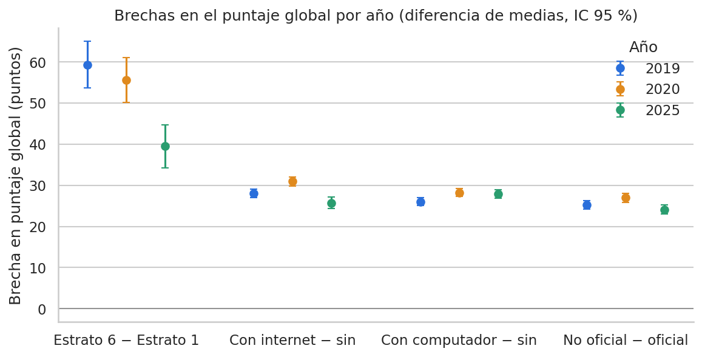

# ETL Saber 11 — Valle del Cauca antes, durante y después de la pandemia (Entrega 2)

## 1. Objetivo
¿Cómo cambió el rendimiento en Saber 11 y su relación con las condiciones socioeconómicas del hogar (estrato, educación de los padres, internet y computador, NSE) entre 2019 (antes), 2020 (durante) y 2025 (después de la pandemia) en el Valle del Cauca?

**Propósito del pipeline.** Automatizar de forma reproducible la extracción, transformación, validación y carga de los resultados de Saber 11 en el Valle del Cauca para tres momentos (2019, 2020 y 2025), de modo que las tres fuentes queden unificadas en un solo modelo de datos y las comparaciones entre periodos se hagan siempre sobre datos validados.

**Insights que debe entregar.**
- Cómo cambió el puntaje global y el de cada prueba entre antes (2019), durante (2020) y después (2025) de la pandemia.
- Cómo se relaciona el rendimiento con el estrato, la educación de los padres, el acceso a internet y computador, y el nivel socioeconómico (NSE) del estudiante.
- Si esas diferencias socioeconómicas se mantuvieron, aumentaron o disminuyeron después de la pandemia.

## 2. Arquitectura


*Figura 1. Arquitectura del pipeline: tres fuentes (CSV 2019, API 2020 y base SQL 2025), un DAG de Airflow en Docker, validación con Great Expectations antes de cargar y un DW en estrella en MySQL. Versión vectorial en `docs/arquitectura.svg`.*

Tres ramas en paralelo producen archivos con la misma estructura (ver sección 4.1), que se apilan, se validan con Great Expectations y se cargan en un modelo estrella en MySQL.

| Rama | Fuente | Año |
|---|---|---|
| CSV | Resultados Saber 11 | 2019 |
| API | datos.gov.co, Saber 11 | 2020 |
| DB | Base de la entrega 1 | 2025 |

## 3. Pasos del pipeline y diseño del DAG.
DAG `saber11_valle_etl` (`dags/saber11_etl_dag.py`):

```
extract_api -> transform_api ┐
read_csv    -> transform_csv ├-> merge -> quality_check -> load -> cleanup_staging -> dashboard_update
read_db     -> transform_db  ┘
```


*Figura 2. Vista Graph del DAG en Airflow: tres ramas en paralelo que convergen en `merge`.*


*Figura 3. Ejecución exitosa de la corrida completa del pipeline en Airflow (todas las tareas en estado success).*

| Tarea | Entrada → salida | Reintentos |
|---|---|---|
| extract_api | API → raw_api.parquet | 3 (5 min, progresivo) |
| transform_api | raw_api → staging_api | 0 |
| read_csv | CSV 2019 → raw_csv.parquet | 1 |
| transform_csv | raw_csv → staging_csv | 0 |
| read_db | MySQL raw_saber11 → raw_db.parquet | 2 (30 s) |
| transform_db | raw_db → staging_db | 0 |
| merge | 3 staging → staging_merged | 0 |
| quality_check | staging_merged → aprueba o falla | 0 |
| load | staging_merged → DW | 0 |
| cleanup_staging | borra temporales (solo si load terminó bien) | 0 |
| dashboard_update | DW → tableros | 0 |

Parámetros: `@daily` técnico (los datos son históricos: la ejecución diaria cumple la consigna de extracción programada, pero en la práctica no cambia nada), `catchup=False`, `max_active_runs=1`, reintento global 0. Los datos pasan entre tareas por archivos parquet en `data/staging`, nunca por XCom.

## 4. Decisiones de transformación.

### 4.1. Estructura común del dataset unificado

Las tres fuentes se llevan a las mismas 25 columnas, en este orden y con estos tipos, antes de apilarlas. Esta estructura está definida en `etl/esquema.py` y `validar_esquema()` la verifica en cada rama y en el *merge*.

| Grupo | Columna | Tipo | Regla |
| :--- | :--- | :--- | :--- |
| **Identificación** | `estu_consecutivo` | Texto | Nunca nulo, sin duplicados. |
| | `periodo` | Texto | Formato `AAAAS` (ej. `20191`), nunca nulo. |
| | `anio` | Entero | Primeros 4 dígitos de `periodo`. |
| | `semestre` | Entero | Último dígito de `periodo`. |
| **Ubicación** | `estu_depto_reside`, `estu_mcpio_reside` | Texto | Residencia del estudiante. |
| **Colegio** | `cole_codigo_icfes` | Entero | `-1` = inscripción individual (se renombra a `cole_cod_icfes` en la Fact). |
| | `cole_nombre_establecimiento`, `cole_naturaleza`, `cole_calendario`, `cole_area_ubicacion` | Texto | Información del establecimiento educativo. |
| **Socioeconómicas** | `fami_estratovivienda`, `fami_educacionpadre`, `fami_educacionmadre`, `fami_tieneinternet`, `fami_tienecomputador`, `fami_personashogar` | Texto | Variables de entorno socioeconómico. |
| | `estu_nse_individual` | Entero | `1` a `4`; `-1` si falta. |
| | `estu_inse_individual` | Decimal | Nulo si falta. |
| **Resultados** | `punt_global` | Entero | `0` a `500`, puede ser nulo. |
| | `punt_matematicas`, `punt_lectura_critica`, `punt_c_naturales`, `punt_sociales_ciudadanas`, `punt_ingles` | Entero | `0` a `100`, pueden ser nulos (se renombra `punt_c_naturales` a `punt_naturales` en la Fact). |

**Filtros:** Solo Valle del Cauca (comparando `UPPER(TRIM(estu_depto_reside))`) y solo los periodos del año de cada fuente, aplicados al leer. Si una fuente no trae una columna (por ejemplo NSE/INSE en el subconjunto `20201`), se crea en nulo; no se inventan valores.

### 4.2. Limpieza compartida (`etl/limpieza.py`)
Es la limpieza de la entrega 1 convertida en una sola función, `limpiar()`, que las tres ramas usan como último paso:
- Texto: repara caracteres corruptos con ftfy, quita espacios y escribe los faltantes como `No informa`. Valores como `nan`, `None` o `NULL` escritos como texto se tratan como faltantes.
- Estudiantes sin colegio: código `-1`, nombre `Sin colegio (inscripción individual)` y `No aplica` en naturaleza, calendario y área.
- NSE faltante = `-1`; INSE faltante = nulo.
- Deduplicación por `estu_consecutivo`, priorizando el registro con colegio sobre la inscripción individual.
- Los renombres `punt_c_naturales → punt_naturales` y `cole_codigo_icfes → cole_cod_icfes` se hacen al cargar al DW.

### 4.3. Diferencias con la entrega 1
- Un mismo estudiante en dos colegios distintos, un periodo que no sea AAAAS o un puntaje con decimales detienen el proceso con un error claro (antes solo era un aviso o pasaban sin revisar).
- Las filas que no encuentran su llave en una dimensión también detienen la carga (antes se descartaban).
- DW nuevo (`saber11_dw_e2`) separado del nacional de la entrega 1, con `COLLATE utf8mb4_bin` para que "Si"/"Sí" o "VALLE"/"Valle" no se mezclen al cargar dimensiones, y `dim_tiempo.etapa_pandemia` (Antes / Durante / Después).

### 4.4. Resultados de la rama DB (2025)
Ficha completa en `docs/ficha_fuente_db.md`.

| Etapa | Resultado |
|---|---|
| Tabla `raw_saber11` (nacional, entrega 1) | 661.891 filas |
| Tras filtro Valle + 2025 (`read_db`) | 50.875 filas (20251: 11.947 · 20252: 38.928) |
| `staging_db.parquet` (`transform_db`) | 50.875 filas, 25 columnas |
| Fact en el DW tras `load` | 50.875 filas |
| Dimensiones | `dim_colegio` 1.798 · `dim_ubicacion` 42 · `dim_socioeconomica` 16.582 · `dim_tiempo` 6 |

Hallazgos: 7.856 estudiantes sin colegio (inscripción individual), 0 filas con llaves nulas, 0 duplicados y 0 dobles inscripciones; 376 colegios con atributos distintos entre registros (aviso informativo de la limpieza).

Pruebas realizadas:
- `pytest`: 9 pruebas de la limpieza, todas pasan.
- `read_db` y `transform_db` corren en local y dentro de Airflow (`airflow tasks test`).
- Repetibilidad: cada ejecución sobreescribe el staging (50.875 filas).
- Idempotencia de la carga: cargar dos veces el mismo staging deja 50.875 filas en la fact.
- Codificación: `etapa_pandemia` se guarda en UTF-8 ("Después").

### 4.5. Resultados de la rama CSV (2019)

Ficha técnica completa en `docs/ficha_fuente_csv.md`.  
**Fuente original:** `2019.csv` (Datos Abiertos ICFES Saber 11 2019, alcance nacional, 459,6 MB, 94 columnas).

| Etapa | Resultado |
|---|---|
| CSV completo (nacional) | 680.893 filas (20191: 66.104 · 20192: 614.789) |
| Tras filtro Valle + 2019 (`read_csv`) | 57.341 filas (20191: 11.624 · 20192: 45.717) |
| `staging_csv.parquet` (`transform_csv`) | 57.341 filas, 25 columnas |

#### Flujo de Transformaciones 

**`read_csv`** (`2019.csv` → `raw_csv.parquet`)
1. **Lectura por bloques:** Procesamiento en bloques de 100.000 filas para optimizar memoria (máximo 216 MB de uso, ~8 s).
2. **Detección de Encoding:** El archivo viene en `latin-1` (ISO-8859-1). `read_csv` intenta UTF-8 y aplica `latin-1` como fallback validado.
3. **Manejo de nulos y tipos:** Carga inicial como texto preservando cadenas nulas (`""`, `NA`, `N/A`, `null`, `NULL`).
4. **Selección de columnas:** Filtrado estricto de las 23 columnas de entrada requeridas por el contrato, descartando las 71 restantes.
5. **Filtro geográfico (Valle del Cauca):** Normalización y filtrado sobre `UPPER(TRIM(estu_depto_reside)) = 'VALLE'`, conservando 57.341 registros (8,4 % del total nacional).
6. **Filtro de periodo:** Confirmación de periodos pertenecientes a 2019 (`20191` y `20192`).
7. **Escritura raw:** Generación de `raw_csv.parquet` (57.341 filas x 23 columnas de texto).

**`transform_csv`** (`raw_csv.parquet` → `staging_csv.parquet`)
8. **Completitud de columnas:** Creación en nulo de variables faltantes en el origen.
9. **Limpieza compartida (`limpiar(df, fuente="csv_2019")`):**
   - *Inscripciones individuales:* 10.784 estudiantes asignados a código `-1`.
   - *Estandarización de texto:* Corrección de espacios y estandarización de faltantes a `"No informa"`.
   - *Tipos numéricos:* Conversión de puntajes a entero, INSE a decimal (12.899 nulos) y NSE a entero (`-1` si falta).
   - *Descomposición temporal:* Asignación de `anio = 2019` y `semestre` (1: 11.624 filas; 2: 45.717 filas).
10. **Escritura staging:** Generación de `staging_csv.parquet` (57.341 filas x 25 columnas unificadas).

#### Hallazgos Clave
- **Datos socioeconómicos en inscritos individuales:** Únicamente 5 de los 10.784 inscritos individuales diligenciaron datos socioeconómicos. Entre la población escolarizada, la ausencia de estrato fue de solo 8,2 %.
- **Validación de puntajes:** Todos los puntajes están dentro del rango válido (0–100 / 0–500). El puntaje global coincide con la fórmula ponderada oficial del ICFES en las 57.189 filas que cuentan con las cinco pruebas completas.
- **Composición por semestre:**
  - `20191` (Calendario B): El 99,7 % de los escolarizados (7.462 de 7.484) pertenecen a colegios No Oficiales (privados), alcanzando un puntaje global medio de 284,4.
  - `20192` (Calendario A): El 78,8 % de los escolarizados (30.774 de 39.073) pertenecen a colegios Oficiales (públicos), con un promedio global de 245,1.

#### Pruebas y Validación
- 5 pruebas unitarias automatizadas en `tests/test_rama_csv.py` (cobertura de filtros, lectura multi-archivo, variables de entorno, manejo de errores, esquema y repetibilidad).
- Repetibilidad e idempotencia confirmadas: ejecuciones sucesivas producen exactamente el mismo staging de 57.341 filas.

---

## 5. API

La rama API trae Saber 11 de 2020 desde datos.gov.co, la plataforma de datos abiertos del Estado. Esta plataforma publica cada conjunto en una dirección con forma **`https://www.datos.gov.co/resource/<id>.json`**, y permite pedir solo las filas que se necesitan en lugar de bajar el archivo completo.

El año 2020 está partido en dos publicaciones, una por periodo, y ninguna cubre sola el año:

| Conjunto | Periodo en la API | Filas del país | Filas de Valle |
|---|---|---|---|
| **a8xr-en99** | **20201** | 15.435 | 6.301 |
| **rnvb-vnyh** | **20204** | 504.872 | 35.442 |

Se usan las dos y se unen en **raw_api.parquet**.

**Por qué esta API**
Es la fuente oficial de los resultados de Saber 11 (ICFES) en datos abiertos, la misma de los otros dos años, y trae casi todas las columnas del esquema con el mismo nombre; solo hay que crear **`estu_nse_individual`** y **`estu_inse_individual`** en **a8xr-en99**. Además es el único origen que tenemos para 2020, deja filtrar Valle dentro de la consulta y funciona sin credenciales que es algo valioso cuando hacemos estos proyectos.

**Las consultas**
- El filtro de Valle **`upper(estu_depto_reside) = 'VALLE'`** se hace dentro de la consulta, para no descargar más de 500.000 filas del país.
- Se ordena por **`estu_consecutivo`** y se pagina de 10.000 en 10.000. Sin un orden fijo, las páginas se pueden repetir o saltar filas.
- Se usa la versión **`/resource/<id>.json`** porque funciona sin credenciales; la versión **/api/v3/views/...** pide autenticación.
- El token de aplicación **`SOCRATA_APP_TOKEN`** es opcional: sin token funciona, solo que más limitado; si se define, se envía en la cabecera **`X-App-Token`**.
- Ante errores temporales o límites de uso la descarga se reintenta sola y adicionalmente, la tarea **`extract_api`** del DAG tiene 3 reintentos con espera progresiva.

**Diferencias entre Datos del ICFES**
- **a8xr-en99** no publica **`estu_nse_individual`** ni **`estu_inse_individual`**; se crean en nulo (NSE queda en **`-1`**).
- La API omite los campos nulos en el JSON, y por eso **`raw_api.parquet`** tiene columnas que algunos registros no traen. Solo se conservan las 23 columnas del esquema.

**Decisión sobre periodo en Datos del 20202**
El conjunto 2020-2 publica el periodo como **`20204`**; la estructura de las tres ramas solo admite semestres 1 o 2 y ninguna de las dos publicaciones trae un **`20202`**, así que la corrección que tomamos no genera ninguna alteración con ningún dato. Nosotros decidimos tratar el **`20204`** como el segundo semestre de 2020 y reasignarlo a **`20202`**, la fuente no explica qué significa el 4, por ello nuestra decisión; el cambio se hace en **`transform_api`**, antes de la limpieza compartida, y **`raw_api.parquet`** conserva el valor original. La ficha de la fuente está en **`docs/ficha_fuente_api.md`**.

## 6. Great Expectations

La tarea **`quality_check`** revisa **`staging_merged.parquet`** con Great Expectations (usamos la versión 1.24.0, que es compatible con la imagen de Airflow del proyecto). Aquí se define un grupo de reglas y un Checkpoint que la ejecuta; si alguna regla falla, la tarea termina con error, **`load`** no corre y los archivos de staging se conservan para revisarlos. El resultado de cada ejecución queda en **`resultado_gx.json`**, dentro de la carpeta de staging.

| Qué revisamos | Regla | Por qué |
|---|---|---|
| Estructura | Existen las 25 columnas, en el orden del esquema | El merge y la carga dependen de la estructura común |
| Llaves | **`estu_consecutivo`** y **`periodo`** sin nulos; **`estu_consecutivo`** único | Es la llave de cada estudiante en la tabla de hechos |
| Tiempo | **`periodo`** con formato AAAAS, año 2019, 2020 o 2025 y semestre 1 o 2 | Cada fuente aporta un año; un periodo raro indica un error de la rama |
| Cobertura | Los tres años presentes, con un mínimo de filas por año | Detecta una carga cortada o una fuente que llegó vacía |
| Ubicación | **`estu_depto_reside`** empieza por VALLE | Solo estamos evaluando Valle del Cauca |
| Puntajes | **`punt_global`** entre 0 y 500; las otras cinco pruebas entre 0 y 100 | Fuera de ese rango el dato es imposible. Los nulos no cuentan |
| Socioeconómicas | NSE entre -1 y 4; internet y computador solo **`Si`**, **`No`** o **`No informa`** | Mantiene las categorías cerradas que usan las dimensiones |
| Colegio | **`cole_codigo_icfes`** mayor o igual a -1; **`cole_area_ubicacion`** solo **`URBANA`**, **`RURAL`** o **`No aplica`**; **`cole_calendario`** solo **`A`**, **`B`**, **`OTRO`** o **`No aplica`** | -1 es el código de inscripción individual; **`URBANO`** se homologa a **`URBANA`** en la limpieza compartida, y las categorías cerradas evitan que se creen dimensiones duplicadas |


**Mínimos de filas por año**
`MIN_FILAS_POR_ANIO` en `quality_check.py`:
- 2019: **50.000** filas VS el real es 57.341
- 2020: **40.000** filas VS el real es 41.743
- 2025: **45.000** filas VS el real es 50.875

Cada mínimo se fijó un poco por debajo del conteo real de su fuente, para detectar cargas incompletas sin que un descarte normal de duplicados dispare la regla de calidad.

**Integración y generación de informes analíticos**
Una vez que Great Expectations valida el archivo unificado `staging_merged.parquet`, los datos pasan a la tarea de carga en MySQL (`load`) y luego a `dashboard_update`, que es la única tarea del DAG que produce un entregable de análisis (el tablero). El EDA y el informe analítico con las pruebas estadísticas formales **no son tareas del DAG**: son cuadernos que se ejecutan en Docker sobre el Data Warehouse ya cargado (sección 9) y generan `reports/eda_saber11.html` y `reports/informe_saber11.html`.

## 7. Análisis Exploratorio de Datos (EDA) e Informe Analítico

Hay dos cuadernos en `notebooks/`. Ambos leen **solo el Data Warehouse** (`saber11_dw_e2`: 149.959 registros que ya pasaron Great Expectations y la carga) y se exportan a HTML en `reports/`. Ninguno es una tarea del DAG: se ejecutan a demanda cuando el DAG ya terminó (ver sección 9).

| Cuaderno | Salida | Para qué sirve |
|---|---|---|
| `eda_saber11.ipynb` | `reports/eda_saber11.html` | Calidad y forma de los datos: faltantes, duplicados, categorías, rangos, atípicos, distribuciones, relaciones y geografía. Justifica las decisiones de transformación (secciones 4 y 5). |
| `informe_saber11.ipynb` | `reports/informe_saber11.html` | Pruebas de hipótesis (ANOVA de Welch, t de Welch, *d* de Cohen, η², interacción año × grupo) para decir si las diferencias son significativas **y** de qué tamaño. |

Las funciones de apoyo (conexión al DW, pruebas estadísticas y gráficos) están en `notebooks/analisis_utils.py`. Todas las cifras del texto se calculan al ejecutar: si el DW cambia, los informes se actualizan solos.

**Alcance.** Las pruebas formales cubren año/etapa, estrato, internet, computador, naturaleza del colegio y áreas. La educación de los padres y el NSE/INSE se exploran solo de forma descriptiva en el EDA (distribución por año y correlación del puntaje global con el INSE, r = 0,40, y con el NSE, r = 0,36); no tienen prueba de hipótesis ni brecha por año.

### 7.1. Resumen del EDA
- **Volumen y carga:** 149.959 registros (57.341 en 2019; 41.743 en 2020; 50.875 en 2025). Las filas del DW coinciden con las esperadas en los tres años y hay 0 llaves de estudiante repetidas.
- **Rangos y atípicos:** 0 valores fuera de rango (global 0–500, áreas 0–100). Con la regla de Tukey, como máximo el 0,38 % del puntaje global de un año queda fuera de los límites y, en las áreas, como máximo el 3,54 % (Inglés 2020). No se eliminan: son resultados posibles.
- **Faltantes:** 9 de las 18 columnas revisadas tienen datos faltantes o «No informa». Los mayores porcentajes son estrato en 2025 (26,1 %), internet en 2025 (25,6 %) y estrato en 2019 (25,4 %). En 2020 son solo 4–5,5 %.
- **NSE/INSE:**
  - En **2019** faltan en 12.899 de los 57.341 registros (~22,5 %, asociados en su mayoría a inscripciones individuales).
  - En **2020**, el subconjunto `20201` no los publica desde la API, mientras que en `20202` (codificado como `20204`) sí están presentes con solo 1.490 faltantes (18,7 % en el año).
  - En **2025** faltan el 25,2 %.
  - En todos los casos los faltantes se rellenan con `-1` para NSE y nulo para INSE, sin imputar datos artificiales.
- **Consistencia de categorías:** las únicas categorías que no aparecen en los tres años son los `No aplica` de colegio (naturaleza, calendario y área), ausentes en 2020 porque la API no trae inscripciones individuales (ver sección 5).
- **Diferenciación de semestres:** el semestre 1 promedia 285,5 puntos y el semestre 2, 248,1. El calendario B es el 67,1 % del semestre 1 y el calendario A el 90,8 % del semestre 2: cada semestre reúne tipos de colegios distintos (entre quienes tienen colegio, en los semestres 1 casi todos son no oficiales y en los semestres 2 predominan los oficiales). Por eso el informe compara siempre dentro del mismo semestre.
- **Composición que cambia entre años:** los estratos 1 y 2 juntos son el 46,8 % de los estudiantes en 2019, el 61,4 % en 2020 y el 42,0 % en 2025; también cambian el acceso a internet y el tipo de colegio.
- **Relaciones:** el puntaje global se asocia más con Ciencias naturales (r = 0,92) y menos con Inglés (r = 0,79). Son asociaciones, no causas.
- **Geografía:** 42 municipios; los 10 mayores reúnen el 84,7 % de los estudiantes y Cali sola el 49,1 %. Entre esos 10, Palmira tiene el mayor promedio (267,2) y Buenaventura el menor (220,2).

### 7.2. Resultados del informe analítico

**Cómo se lee.** Con decenas de miles de estudiantes casi cualquier diferencia sale «significativa», así que la decisión de si una diferencia importa se basa en el tamaño del efecto (*d* de Cohen: < 0,2 insignificante, < 0,5 pequeño, < 0,8 mediano; η²: < 0,01 insignificante, < 0,06 pequeño, < 0,14 mediano) y no solo en el valor *p* (Bonferroni en las comparaciones múltiples, α = 0,05). Para decir si una brecha **cambió** entre años se usan dos criterios a la vez: la interacción año × grupo (¿hay cambio estadístico?) y el rango de la brecha frente a un umbral de 0,1 desviaciones estándar del puntaje global (≈ 5,3 puntos). El texto de las conclusiones tiene tres resultados posibles:

| Condición | Redacción del informe |
|---|---|
| Interacción significativa y rango ≥ 5,3 puntos | La brecha **cambió** entre años |
| Interacción significativa y rango entre 4,0 y 5,3 puntos (≥ 75 % del umbral) | La brecha **varió poco**: cambio pequeño, no una brecha idéntica |
| Cualquier otro caso | La brecha se mantuvo **prácticamente igual** |

| Pregunta | Resultado | Lectura |
|---|---|---|
| **P1.** Puntaje global (mismo semestre) | Semestre 1: 284,4 (2019), 290,1 (2020), 284,1 (2025). Semestre 2: 245,1, 245,1 y 254,4. Frente a 2019 el cambio va de 0,0 a 9,3 puntos; η² = 0,0019 (sem. 1) y 0,0076 (sem. 2). | Todos los efectos son **insignificantes** (\|*d*\| ≤ 0,18). El mayor cambio es +9,3 puntos en el semestre 2 de 2025 (*d* = 0,18). |
| **P2.** Estrato 6 − estrato 1 | 59,4 (2019), 55,6 (2020) y 39,5 (2025) puntos; *d* = 1,24, 1,26 y 0,76. η² del estrato: 0,077, 0,076 y 0,027. | La brecha pasó de **grande** a **mediana** y el estrato explica menos variación (de efecto mediano a pequeño). Es la única brecha que **cambió** de forma relevante (casi 20 puntos). |
| **P3.** Internet (con − sin) | 28,0, 30,9 y 25,7 puntos; *d* = 0,55, 0,65 y 0,48. | **Varió poco** (5,2 puntos, cerca del límite de 5,3). Efecto mediano/pequeño. |
| **P3.** Computador (con − sin) | 26,0, 28,2 y 27,9 puntos; *d* = 0,51, 0,60 y 0,53. | **Prácticamente igual** (2,2 puntos; la interacción es significativa, *p* = 0,004, pero el cambio es pequeño). Efecto mediano. |
| **P4.** No oficial − oficial | 25,3, 26,9 y 24,1 puntos; *d* = 0,49, 0,56 y 0,45. | **Prácticamente igual** (2,8 puntos). Se excluyen 18.640 estudiantes con inscripción individual. Está mezclada con el estrato: no se atribuye al tipo de colegio por sí solo. |
| **P5.** Áreas (cambio vs 2019) | 2025: Inglés +3,87 (*d* = 0,28), Ciencias naturales +1,96, Matemáticas +1,46, Lectura crítica +1,42, Sociales +1,07. 2020: entre −1,55 (Inglés) y +0,56 (Sociales). | Solo Inglés 2025 llega a efecto **pequeño**; el resto es insignificante (*d* ≤ 0,17). |



*Figura 4. Brecha en el puntaje global por año (diferencia de medias con IC 95 %) para estrato, internet, computador y naturaleza del colegio. Se genera al ejecutar `informe_saber11.ipynb`.*

**Conclusión general.** Después de comparar el mismo semestre, el puntaje global de 2025 no es relevantemente distinto del de 2019 (el cambio más grande tiene *d* = 0,18) y la mejora más clara está en Inglés. Las brechas por internet, computador y tipo de colegio se mantienen entre 24 y 31 puntos (efectos pequeños a medianos) y la de estrato es la mayor, pero se redujo en 2025. Todo es asociación: el estudio es observacional.

### 7.3. Limitaciones
- **Estudio observacional:** las diferencias son asociaciones; no se puede afirmar que la pandemia causó un cambio.
- **Composición distinta por semestre:** los años no tienen la misma proporción de estudiantes por semestre y los semestres difieren mucho; por eso los promedios anuales (253,1; 251,9; 261,4) no son comparables por sí solos.
- **Datos de 2020 (API):** el segundo periodo viene como `20204` y se agrupó con `20202`; además la fuente no incluye estudiantes con inscripción individual (sin colegio), que sí están en 2019 y 2025.
- **Faltantes distintos por año:** en 2019 y 2025 cerca del 25 % (22–26 %) no informa estrato, internet o computador, y en 2020 solo el 4–5,5 %. Una parte es estructural: las inscripciones individuales (18,8 % de 2019 y 15,4 % de 2025) casi no diligencian el cuestionario socioeconómico (en 2019, solo 5 de 10.784) y la API de 2020 no las trae. Aun así, si quienes no informan son distintos del resto, las brechas entre años pueden verse afectadas.
- **Exclusión de «No informa»:** quienes no informan estrato, internet o computador se excluyen de la brecha correspondiente (cada sección del informe indica el porcentaje excluido).
- **Significancia y tamaño:** con muestras grandes un *p* pequeño no implica una diferencia importante; por eso se reporta el tamaño del efecto. El umbral de 0,1 desviaciones estándar para decir que una brecha cambió es un criterio práctico del informe, no una regla estadística universal.
- **Comparabilidad de ediciones:** se asume que los puntajes de 2019, 2020 y 2025 están en la misma escala (0–500).

### 7.4. Dashboard y Hallazgos Socioeconómicos
El dashboard interactivo fue construido consultando directamente el Data Warehouse validado (`saber11_dw_e2`) y exportado a `dashboards/saber11_valle.html`.


*Figura 5. Indicadores globales y promedio de puntaje por área antes (2019), durante (2020) y después (2025) de la pandemia.*


*Figura 6. Relación del puntaje global con estrato, naturaleza del colegio, acceso a internet y tabla resumen por periodo.*

#### Principales Insights Extraídos:
1. **Comportamiento Temporal y Semestre:**
   - **Puntaje Promedio Global Consolidado:** el promedio de los 149.959 registros es de **255,6 puntos** (253,1 en 2019, 251,9 en 2020 y 261,4 en 2025; estos promedios anuales no son comparables por sí solos porque cada año mezcla proporciones distintas de semestres).
   - **Efecto del semestre (composición, no estacionalidad):** los periodos `20191` (284,37), `20201` (290,12) y `20251` (284,07) promedian bastante más que `20192` (245,14), `20202` (245,13) y `20252` (254,40). La diferencia refleja el tipo de colegio de cada semestre (calendario B, mayoritariamente no oficial, en el primero; calendario A, mayoritariamente oficial, en el segundo), no una estacionalidad del examen.
   - **Diferencias en 2025 frente a 2019:** todas las áreas suben, pero solo **Inglés** lo hace con efecto pequeño (50,2 → 48,7 → 54,1 en 2019, 2020 y 2025; *d* = 0,28). Ciencias naturales (+1,96), Matemáticas (+1,46) y Lectura crítica (+1,42) aumentan con efectos insignificantes. Son diferencias observadas, no una «recuperación» atribuible a una causa.

2. **Brecha Digital (Acceso a Internet):**
   - Los estudiantes con internet en el hogar obtienen promedios más altos en los tres años (~267 puntos en 2025 frente a ~241 sin conectividad; brecha de 25,7 puntos, *d* = 0,48). Es la brecha de internet más baja de los tres años (28,0 en 2019 y 30,9 en 2020). Es una asociación que se mezcla con el nivel socioeconómico del hogar, no un efecto causal.

3. **Estratificación y Brecha Institucional:**
   - **Estrato Socioeconómico:** el puntaje crece con el estrato. Los estratos 5 y 6 promedian entre 288,9 y 296,2 puntos según el año, mientras que los estratos 1 y 2 van de 236,9 (estrato 1, 2019) a 263,8 (estrato 2, 2025). La brecha entre el estrato 6 y el 1 se redujo de 59,4 puntos en 2019 a 39,5 en 2025, sobre todo porque los estratos 1 y 2 suben en 2025.
   - **Naturaleza del Colegio:** la brecha entre colegios **No Oficiales (Privados)** y **Oficiales (Públicos)** se mantuvo en el tiempo (25,3, 26,9 y 24,1 puntos). En 2025, los colegios privados promedian cerca de 277 puntos frente a 253 de los públicos, diferencia que está mezclada con el estrato de las familias.

## 8. Modelo de datos

Modelo en estrella en MySQL (base `saber11_dw_e2`, script `sql/esquema_dw.sql`). **Granularidad:** una fila de la fact por estudiante (`bk_estu_consecutivo`).


*Figura 7. Modelo en estrella: la fact `fact_resultadossaber11` y sus cuatro dimensiones.*

| Tabla | Contenido | Llaves |
|---|---|---|
| `fact_resultadossaber11` | Puntaje global, puntajes por prueba (matemáticas, lectura crítica, naturales, sociales y ciudadanas, inglés) e INSE individual | PK `id_resultado`; FK `id_colegio`, `id_ubicacion`, `id_socioeconomico`, `id_tiempo`; único `bk_estu_consecutivo` |
| `dim_colegio` | Código ICFES, nombre, naturaleza, calendario y área de ubicación del colegio | PK `id_colegio`; único `cole_cod_icfes` (`-1` = inscripción individual) |
| `dim_ubicacion` | Departamento y municipio de residencia del estudiante | PK `id_ubicacion`; único (departamento, municipio) |
| `dim_socioeconomica` | Estrato, educación del padre y de la madre, internet, computador, personas en el hogar y NSE | PK `id_socioeconomico`; único la combinación de las 7 columnas |
| `dim_tiempo` | Periodo, año, semestre y etapa de la pandemia (Antes / Durante / Después) | PK `id_tiempo`; único `periodo` |

**Decisiones de diseño:**
- **Unicidad e Idempotencia:** Cada dimensión guarda una fila por combinación única de valores (restricción `UNIQUE`). La carga se realiza con `INSERT IGNORE`, garantizando que volver a ejecutar el pipeline no duplique registros ni modifique IDs ya existentes.
- **Integridad Referencial Estricta:** La Fact table no admite llaves nulas hacia las dimensiones: si una fila de la tabla de hechos no encuentra su correspondiente combinación en alguna dimensión, la tarea `load` se detiene inmediatamente con un error explícito en vez de ignorar el registro.
- **Colación de Texto:** Todas las tablas están definidas con `COLLATE utf8mb4_bin`. Esto evita que cadenas con diferencias ortográficas o de tildes (como `"Si"` / `"Sí"` o `"VALLE"` / `"Valle"`) se mezclen como equivalentes al insertar registros en las dimensiones.
- **Clasificación Temporal:** La dimensión `dim_tiempo.etapa_pandemia` asigna la etiqueta correspondiente a cada periodo (`2019` → Antes, `2020` → Durante, `2025` → Después), optimizando los filtros del dashboard y del informe analítico.
- **Estandarización de Nombres en la Fact:** Durante la fase de limpieza en staging se mantienen los nombres originales `punt_c_naturales` y `cole_codigo_icfes`. Únicamente al momento de la carga a MySQL se renombran formalmente a `punt_naturales` y `cole_cod_icfes` para coincidir con la DDL del Data Warehouse.

## 9. Cómo correrlo desde cero
Probado en Windows con PowerShell y Docker Desktop.

1. Instalar Docker Desktop y Git.
2. `git clone https://github.com/valegcollazos/ETL_ENTREGA_02_PROYECTO.git` y entrar a la carpeta.
3. Crear el `.env`: `copy .env.example .env` (Mac/Linux: `cp .env.example .env`) y cambiar `MYSQL_ROOT_PASSWORD` y `MYSQL_PASSWORD`.
4. Descargar el CSV 2019 (`saber11_2019.csv`, disponible en el enlace de Google Drive del equipo: [saber11_2019.csv en Google Drive](https://drive.google.com/file/d/1YxV7oSol4Bg1qfXvLV-L4b6J4tc1eMkd/view?usp=drive_link)), y guardarlo en la carpeta `data/input/saber11_2019.csv`. Viene en latin-1; `read_csv` lo detecta solo.
5. `docker compose up -d --build`. Con `docker compose ps`, `mysql` y `postgres` deben estar `healthy`; `airflow-init` termina solo con `exited (0)`. El MySQL del proyecto queda en el puerto 3307.
6. Descargar [raw_saber11.zip](https://drive.google.com/file/d/1AN8FpzTootHtXAvN6IH5E8Vl9OXivSOs/view?usp=drive_link), descomprimirlo en `dumps/` y cargarlo siguiendo `docs/fuente_db_carga_raw.md`. Verificación (debe dar 661891):

```powershell
"SELECT COUNT(*) FROM saber11.raw_saber11;" | docker compose exec -T mysql sh -c 'mysql -u$MYSQL_USER -p$MYSQL_PASSWORD'
```

7. Abrir http://localhost:8080 (usuario y contraseña `admin`), activar `saber11_valle_etl` y ejecutarlo con *Trigger DAG*. En la vista Grid todas las tareas deben quedar en verde.

8. Revisar el resultado en el Data Warehouse (deben aparecer los tres años: 2019, 2020 y 2025):

```powershell
  "SELECT t.anio, t.etapa_pandemia, COUNT(*) FROM fact_resultadossaber11 f JOIN dim_tiempo t USING (id_tiempo) GROUP BY t.anio, t.etapa_pandemia;" | docker compose exec -T mysql sh -c 'mysql -u$MYSQL_USER -p$MYSQL_PASSWORD saber11_dw_e2'
```
9. Generar los informes analíticos en HTML (opcional pero recomendado). Los dos cuadernos leen directamente del Data Warehouse, así que el DAG debe haber terminado antes:

```powershell
# EDA: calidad y distribución de los datos
docker compose --profile analisis run --rm jupyter jupyter nbconvert --to html --execute --no-input eda_saber11.ipynb --output-dir /work/reports --output eda_saber11

# Informe analítico: pruebas estadísticas de hipótesis
docker compose --profile analisis run --rm jupyter jupyter nbconvert --to html --execute --no-input informe_saber11.ipynb --output-dir /work/reports --output informe_saber11
```

Los resultados quedan en `reports/eda_saber11.html` y `reports/informe_saber11.html`, y las figuras en `reports/figuras/`. Para abrir los cuadernos de forma interactiva: `docker compose --profile analisis up -d jupyter` y entrar a http://localhost:8888 (token `saber11`). La imagen se define en `notebooks/Dockerfile` (JupyterLab, pandas, scipy, seaborn, SQLAlchemy y PyMySQL).

Dentro de Docker, el servicio `jupyter` toma las credenciales del `.env` y `docker-compose.yml` le fija `MYSQL_HOST=mysql` y `MYSQL_PORT=3306`; monta `notebooks/` y `reports/`, por eso los HTML y las figuras quedan en tu carpeta del proyecto. Fuera de Docker, `analisis_utils.conectar()` lee `MYSQL_USER`, `MYSQL_PASSWORD`, `MYSQL_HOST`, `MYSQL_PORT` y `DW_DB_NAME` (por defecto `saber11_dw_e2`); desde el equipo anfitrión el MySQL del proyecto está en `localhost:3307`.

Pruebas unitarias (limpieza, rama CSV y funciones estadísticas del informe): `pytest -q` desde la raíz del proyecto.

## 10. Estructura
```
dags/        DAG de Airflow (tareas y orquestación)
etl/         Definición de esquema, limpieza compartida, ramas (api, csv, db), merge, calidad y carga
sql/         Esquemas DDL para el Data Warehouse y bases de datos
scripts/     Utilidades: generar_muestra_referencia.py crea docs/muestra_referencia.parquet (200 filas de un staging válido, con casos especiales) para probar la validación sin correr el pipeline completo
docs/        Fichas técnicas de las fuentes, diagramas de arquitectura y modelos
notebooks/   EDA (eda_saber11.ipynb), informe analítico (informe_saber11.ipynb), utilidades (analisis_utils.py) y Dockerfile de Jupyter
dashboards/  Tableros HTML interactivos alimentados directamente del DW
reports/     Informe analítico (informe_saber11.html), EDA (eda_saber11.html) y figuras generadas (figuras/)
tests/       Pruebas unitarias con pytest: limpieza, rama CSV y funciones estadísticas del informe
```
