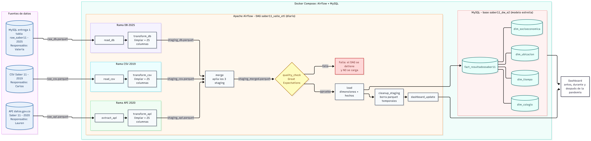
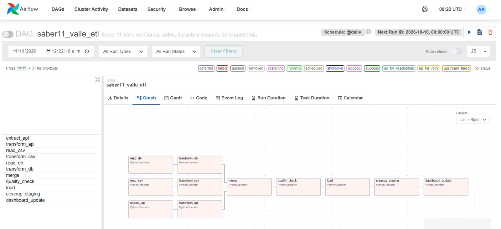
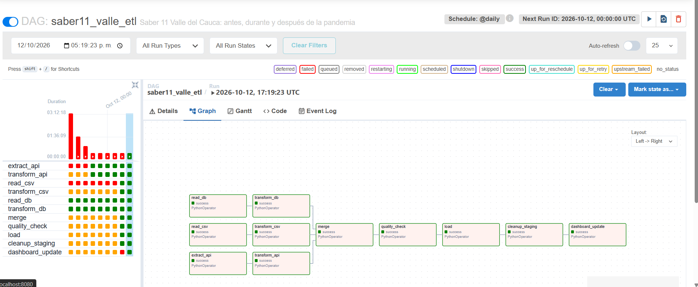
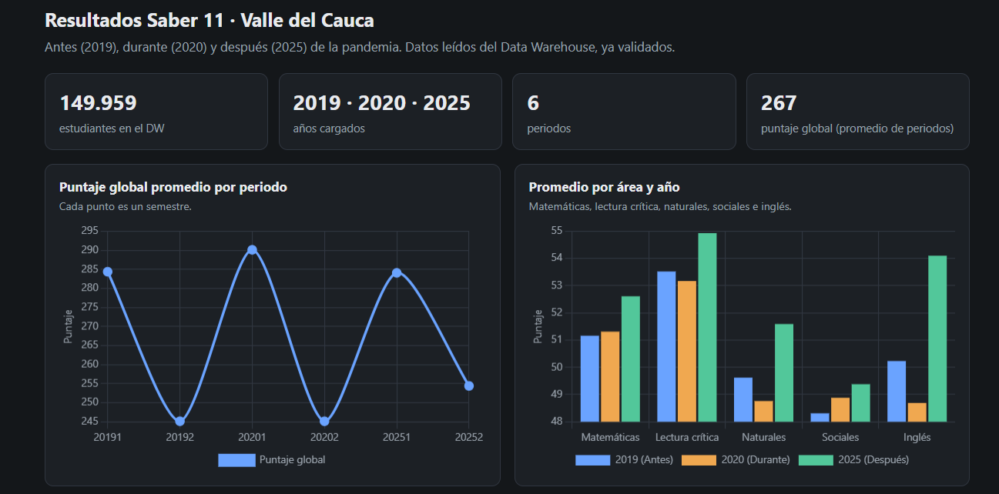
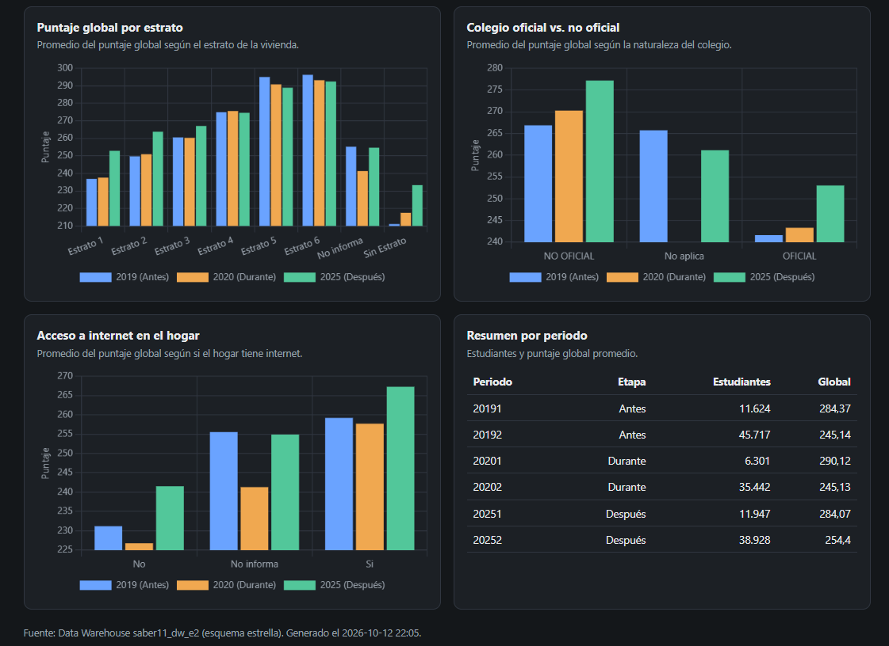
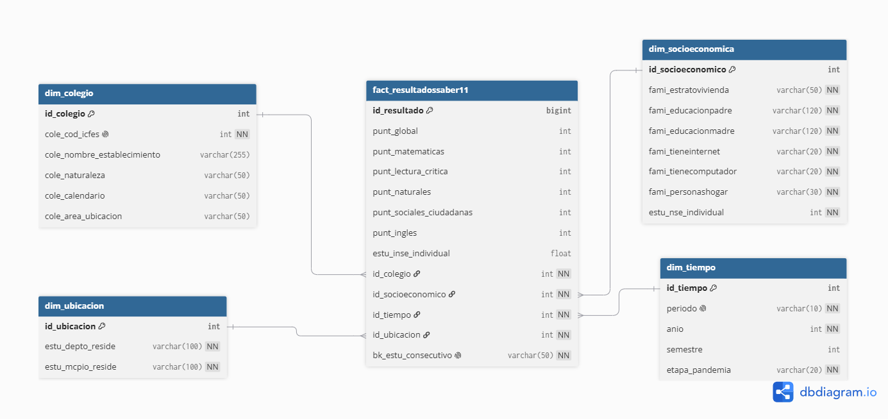

# ETL Saber 11 — Valle del Cauca antes, durante y después de la pandemia (Entrega 2)

## 1.Objetivo
¿Cómo cambió el rendimiento en Saber 11 y su relación con las condiciones socioeconómicas del hogar (estrato, educación de los padres, internet y computador, NSE) entre 2019 (antes), 2020 (durante) y 2025 (después de la pandemia) en el Valle del Cauca?

**Propósito del pipeline.** Automatizar de forma reproducible la extracción, transformación, validación y carga de los resultados de Saber 11 en el Valle del Cauca para tres momentos (2019, 2020 y 2025), de modo que las tres fuentes queden unificadas en un solo modelo de datos y las comparaciones entre periodos se hagan siempre sobre datos validados.

**Insights que debe entregar.**
- Cómo cambió el puntaje global y el de cada prueba entre antes (2019), durante (2020) y después (2025) de la pandemia.
- Cómo se relaciona el rendimiento con el estrato, la educación de los padres, el acceso a internet y computador, y el nivel socioeconómico (NSE) del estudiante.
- Si esas diferencias socioeconómicas se mantuvieron, aumentaron o disminuyeron después de la pandemia.

## 2.Arquitectura



*Figura 1. Arquitectura del pipeline: tres fuentes (CSV 2019, API 2020 y base SQL 2025), un DAG de Airflow en Docker, validación con Great Expectations antes de cargar y un DW en estrella en MySQL. Versión vectorial en `docs/arquitectura.svg`.*

Tres ramas en paralelo producen archivos con la misma estructura (ver sección 4.1), que se apilan, se validan con Great Expectations y se cargan en un modelo estrella en MySQL.

| Rama | Fuente | Año |
|---|---|---|
| CSV | Resultados Saber 11 | 2019 |
| API | datos.gov.co, Saber 11 | 2020 |
| DB | Base de la entrega 1 | 2025 |

## 3.Pasos del pipeline y diseño del DAG.
DAG `saber11_valle_etl` (`dags/saber11_etl_dag.py`):

```
extract_api -> transform_api ┐
read_csv    -> transform_csv ├-> merge -> quality_check -> load -> cleanup_staging -> dashboard_update
read_db     -> transform_db  ┘
```


*Figura 2. Vista Graph del DAG en Airflow: tres ramas en paralelo que convergen en `merge`.*



*Figura 3. Ejecución exitosa de la corrida completa del pipeline en Airflow (todas las tareas en estado success).*

| Tarea | Entrada → salida | Reintentos |
|---|---|---|
| extract_api | API → raw_api.parquet | 3 (5 min, progresivo) |
| transform_api | raw_api → staging_api | 0 |
| read_csv | CSV 2019 → raw_csv.parquet | 1 |
| transform_csv | raw_csv → staging_csv | 0 |
| read_db | MySQL raw_saber11 → raw_db.parquet | 2 (30 s) |
| transform_db | raw_db → staging_db | 0 |
| merge | 3 staging → staging_merged | 0 |
| quality_check | staging_merged → aprueba o falla | 0 |
| load | staging_merged → DW | 0 |
| cleanup_staging | borra temporales (solo si load terminó bien) | 0 |
| dashboard_update | DW → tableros | 0 |

Parámetros: `@daily` técnico (los datos son históricos: la ejecución diaria cumple la consigna de extracción programada, pero en la práctica no cambia nada), `catchup=False`, `max_active_runs=1`, reintento global 0. Los datos pasan entre tareas por archivos parquet en `data/staging`, nunca por XCom.

## 4.Decisiones de transformación.

### 4.1. Estructura común del dataset unificado

Las tres fuentes se llevan a las mismas 25 columnas, en este orden y con estos tipos, antes de apilarlas. Esta estructura está definida en `etl/esquema.py` y `validar_esquema()` la verifica en cada rama y en el *merge*.

| Grupo | Columna | Tipo | Regla |
| :--- | :--- | :--- | :--- |
| **Identificación** | `estu_consecutivo` | Texto | Nunca nulo, sin duplicados. |
| | `periodo` | Texto | Formato `AAAAS` (ej. `20191`), nunca nulo. |
| | `anio` | Entero | Primeros 4 dígitos de `periodo`. |
| | `semestre` | Entero | Último dígito de `periodo`. |
| **Ubicación** | `estu_depto_reside`, `estu_mcpio_reside` | Texto | Residencia del estudiante. |
| **Colegio** | `cole_codigo_icfes` | Entero | `-1` = inscripción individual (se renombra a `cole_cod_icfes` en la Fact). |
| | `cole_nombre_establecimiento`, `cole_naturaleza`, `cole_calendario`, `cole_area_ubicacion` | Texto | Información del establecimiento educativo. |
| **Socioeconómicas** | `fami_estratovivienda`, `fami_educacionpadre`, `fami_educacionmadre`, `fami_tieneinternet`, `fami_tienecomputador`, `fami_personashogar` | Texto | Variables de entorno socioeconómico. |
| | `estu_nse_individual` | Entero | `1` a `4`; `-1` si falta. |
| | `estu_inse_individual` | Decimal | Nulo si falta. |
| **Resultados** | `punt_global` | Entero | `0` a `500`, puede ser nulo. |
| | `punt_matematicas`, `punt_lectura_critica`, `punt_c_naturales`, `punt_sociales_ciudadanas`, `punt_ingles` | Entero | `0` a `100`, pueden ser nulos (se renombra `punt_c_naturales` a `punt_naturales` en la Fact). |

**Filtros:** Solo Valle del Cauca (comparando `UPPER(TRIM(estu_depto_reside))`) y solo los periodos del año de cada fuente, aplicados al leer. Si una fuente no trae una columna (por ejemplo NSE/INSE en el subconjunto `20201`), se crea en nulo; no se inventan valores.

### 4.2. Limpieza compartida (`etl/limpieza.py`)
Es la limpieza de la entrega 1 convertida en una sola función, `limpiar()`, que las tres ramas usan como último paso:
- Texto: repara caracteres corruptos con ftfy, quita espacios y escribe los faltantes como `No informa`. Valores como `nan`, `None` o `NULL` escritos como texto se tratan como faltantes.
- Estudiantes sin colegio: código `-1`, nombre `Sin colegio (inscripción individual)` y `No aplica` en naturaleza, calendario y área.
- NSE faltante = `-1`; INSE faltante = nulo.
- Deduplicación por `estu_consecutivo`, priorizando el registro con colegio sobre la inscripción individual.
- Los renombres `punt_c_naturales → punt_naturales` y `cole_codigo_icfes → cole_cod_icfes` se hacen al cargar al DW.

### 4.3. Diferencias con la entrega 1
- Un mismo estudiante en dos colegios distintos, un periodo que no sea AAAAS o un puntaje con decimales detienen el proceso con un error claro (antes solo era un aviso o pasaban sin revisar).
- Las filas que no encuentran su llave en una dimensión también detienen la carga (antes se descartaban).
- DW nuevo (`saber11_dw_e2`) separado del nacional de la entrega 1, con `COLLATE utf8mb4_bin` para que "Si"/"Sí" o "VALLE"/"Valle" no se mezclen al cargar dimensiones, y `dim_tiempo.etapa_pandemia` (Antes / Durante / Después).

### 4.4. Resultados de la rama DB (2025)
Ficha completa en `docs/ficha_fuente_db.md`.

Etapa | Resultado |
|---|---|
| Tabla `raw_saber11` (nacional, entrega 1) | 661.891 filas |
| Tras filtro Valle + 2025 (`read_db`) | 50.875 filas (20251: 11.947 · 20252: 38.928) |
| `staging_db.parquet` (`transform_db`) | 50.875 filas, 25 columnas |
| Fact en el DW tras `load` | 50.875 filas |
| Dimensiones | `dim_colegio` 1.267 · `dim_ubicacion` 42 · `dim_socioeconomica` 8.699 · `dim_tiempo` 2 |

Hallazgos: 7.856 estudiantes sin colegio (inscripción individual), 0 filas con llaves nulas, 0 duplicados y 0 dobles inscripciones; 376 colegios con atributos distintos entre registros (aviso informativo de la limpieza).

Pruebas realizadas:
- `pytest`: 9 pruebas de la limpieza, todas pasan.
- `read_db` y `transform_db` corren en local y dentro de Airflow (`airflow tasks test`).
- Repetibilidad: cada ejecución sobreescribe el staging (50.875 filas).
- Idempotencia de la carga: cargar dos veces el mismo staging deja 50.875 filas en la fact.
- Codificación: `etapa_pandemia` se guarda en UTF-8 ("Después").

### 4.5. Resultados de la rama CSV (2019)

Ficha técnica completa en `docs/ficha_fuente_csv.md`.  
**Fuente original:** `2019.csv` (Datos Abiertos ICFES Saber 11 2019, alcance nacional, 459,6 MB, 94 columnas).

| Etapa | Resultado |
|---|---|
| CSV completo (nacional) | 680.893 filas (20191: 66.104 · 20192: 614.789) |
| Tras filtro Valle + 2019 (`read_csv`) | 57.341 filas (20191: 11.624 · 20192: 45.717) |
| `staging_csv.parquet` (`transform_csv`) | 57.341 filas, 25 columnas |

#### Flujo de Transformaciones 

**`read_csv`** (`2019.csv` → `raw_csv.parquet`)
1. **Lectura por bloques:** Procesamiento en bloques de 100.000 filas para optimizar memoria (máximo 216 MB de uso, ~8 s).
2. **Detección de Encoding:** El archivo viene en `latin-1` (ISO-8859-1). `read_csv` intenta UTF-8 y aplica `latin-1` como fallback validado.
3. **Manejo de nulos y tipos:** Carga inicial como texto preservando cadenas nulas (`""`, `NA`, `N/A`, `null`, `NULL`).
4. **Selección de columnas:** Filtrado estricto de las 23 columnas de entrada requeridas por el contrato, descartando las 71 restantes.
5. **Filtro geográfico (Valle del Cauca):** Normalización y filtrado sobre `UPPER(TRIM(estu_depto_reside)) = 'VALLE'`, conservando 57.341 registros (8,4 % del total nacional).
6. **Filtro de periodo:** Confirmación de periodos pertenecientes a 2019 (`20191` y `20192`).
7. **Escritura raw:** Generación de `raw_csv.parquet` (57.341 filas x 23 columnas de texto).

**`transform_csv`** (`raw_csv.parquet` → `staging_csv.parquet`)
8. **Completitud de columnas:** Creación en nulo de variables faltantes en el origen.
9. **Limpieza compartida (`limpiar(df, fuente="csv_2019")`):**
   - *Inscripciones individuales:* 10.784 estudiantes asignados a código `-1`.
   - *Estandarización de texto:* Corrección de espacios y estandarización de faltantes a `"No informa"`.
   - *Tipos numéricos:* Conversión de puntajes a entero, INSE a decimal (12.899 nulos) y NSE a entero (`-1` si falta).
   - *Descomposición temporal:* Asignación de `anio = 2019` y `semestre` (1: 11.624 filas; 2: 45.717 filas).
10. **Escritura staging:** Generación de `staging_csv.parquet` (57.341 filas x 25 columnas unificadas).

#### Hallazgos Clave
- **Datos socioeconómicos en inscritos individuales:** Únicamente 5 de los 10.784 inscritos individuales diligenciaron datos socioeconómicos. Entre la población escolarizada, la ausencia de estrato fue de solo 8,2 %.
- **Validación de puntajes:** Todos los puntajes están dentro del rango válido (0–100 / 0–500). El puntaje global coincide con la fórmula ponderada oficial del ICFES en las 57.189 filas que cuentan con las cinco pruebas completas.
- **Composición por semestre:**
  - `20191` (Calendario B): El 99,7 % de los escolarizados (7.462 de 7.484) pertenecen a colegios No Oficiales (privados), alcanzando un puntaje global medio de 284,4.
  - `20192` (Calendario A): El 78,8 % de los escolarizados (30.774 de 39.073) pertenecen a colegios Oficiales (públicos), con un promedio global de 245,1.

#### Pruebas y Validación
- 5 pruebas unitarias automatizadas en `tests/test_rama_csv.py` (cobertura de filtros, lectura multi-archivo, variables de entorno, manejo de errores, esquema y repetibilidad).
- Repetibilidad e idempotencia confirmadas: ejecuciones sucesivas producen exactamente el mismo staging de 57.341 filas.

---

## 5. API

La rama API trae Saber 11 de 2020 desde datos.gov.co, la plataforma de datos abiertos del Estado. Esta plataforma publica cada conjunto en una dirección con forma **`https://www.datos.gov.co/resource/<id>.json`**, y permite pedir solo las filas que se necesitan en lugar de bajar el archivo completo.

El año 2020 está partido en dos publicaciones, una por periodo, y ninguna cubre sola el año:

| Conjunto | Periodo en la API | Filas del país | Filas de Valle |
|---|---|---|---|
| **a8xr-en99** | **20201** | 15.435 | 6.301 |
| **rnvb-vnyh** | **20204** | 504.872 | 35.442 |

Se usan las dos y se unen en **raw_api.parquet**.

**Las consultas**
- El filtro de Valle **`upper(estu_depto_reside) = 'VALLE'`** se hace dentro de la consulta, para no descargar más de 500.000 filas del país.
- Se ordena por **`estu_consecutivo`** y se pagina de 10.000 en 10.000. Sin un orden fijo, las páginas se pueden repetir o saltar filas.
- Se usa la versión **`/resource/<id>.json`** porque funciona sin credenciales; la versión **/api/v3/views/...** pide autenticación.
- El token de aplicación **`SOCRATA_APP_TOKEN`** es opcional: sin token funciona, solo que más limitado; si se define, se envía en la cabecera **`X-App-Token`**.
- Ante errores temporales o límites de uso la descarga se reintenta sola y adicionalmente, la tarea **`extract_api`** del DAG tiene 3 reintentos con espera progresiva.

**Diferencias entre Datos del ICFES**
- **a8xr-en99** no publica **`estu_nse_individual`** ni **`estu_inse_individual`**; se crean en nulo (NSE queda en **`-1`**).
- La API omite los campos nulos en el JSON, y por eso **`raw_api.parquet`** tiene columnas que algunos registros no traen. Solo se conservan las 23 columnas del esquema.

**Decisión sobre periodo en Datos del 20202**
El conjunto 2020-2 publica el periodo como **`20204`**; la estructura de las tres ramas solo admite semestres 1 o 2 y ninguna de las dos publicaciones trae un **`20202`**, así que la corrección que tomamos no genera ninguna alteración con ningún dato. Nosotros decidimos tratar el **`20204`** como el segundo semestre de 2020 y reasignarlo a **`20202`**, la fuente no explica qué significa el 4, por ello nuestra decisión; el cambio se hace en **`transform_api`**, antes de la limpieza compartida, y **`raw_api.parquet`** conserva el valor original. La ficha de la fuente está en **`docs/ficha_fuente_api.md`**.

## 6. Great Expectations

La tarea **`quality_check`** revisa **`staging_merged.parquet`** con Great Expectations (usamos la versión 1.24.0, que es compatible con la imagen de Airflow del proyecto). Aquí se define un grupo de reglas y un Checkpoint que la ejecuta; si alguna regla falla, la tarea termina con error, **`load`** no corre y los archivos de staging se conservan para revisarlos. El resultado de cada ejecución queda en **`resultado_gx.json`**, dentro de la carpeta de staging.

| Qué revisamos | Regla | Por qué |
|---|---|---|
| Estructura | Existen las 25 columnas, en el orden del esquema | El merge y la carga dependen de la estructura común |
| Llaves | **`estu_consecutivo`** y **`periodo`** sin nulos; **`estu_consecutivo`** único | Es la llave de cada estudiante en la tabla de hechos |
| Tiempo | **`periodo`** con formato AAAAS, año 2019, 2020 o 2025 y semestre 1 o 2 | Cada fuente aporta un año; un periodo raro indica un error de la rama |
| Cobertura | Los tres años presentes, con un mínimo de filas por año | Detecta una carga cortada o una fuente que llegó vacía |
| Ubicación | **`estu_depto_reside`** empieza por VALLE | Solo estamos evaluando Valle del Cauca |
| Puntajes | **`punt_global`** entre 0 y 500; las otras cinco pruebas entre 0 y 100 | Fuera de ese rango el dato es imposible. Los nulos no cuentan |
| Socioeconómicas | NSE entre -1 y 4; internet y computador solo **`Si`**, **`No`** o **`No informa`** | Mantiene las categorías cerradas que usan las dimensiones |
| Colegio | **`cole_codigo_icfes`** mayor o igual a -1; **`cole_area_ubicacion`** solo **`URBANA`**, **`RURAL`** o **`No aplica`**; **`cole_calendario`** solo **`A`**, **`B`**, **`OTRO`** o **`No aplica`** | -1 es el código de inscripción individual; **`URBANO`** se homologa a **`URBANA`** en la limpieza compartida, y las categorías cerradas evitan que se creen dimensiones duplicadas |


**Mínimos de filas por año**
`MIN_FILAS_POR_ANIO` en `quality_check.py`:
- 2019: **50.000** filas VS el real es 57.341
- 2020: **40.000** filas VS el real es 41.743
- 2025: **45.000** filas VS el real es 50.875

Cada mínimo se fijó un poco por debajo del conteo real de su fuente, para detectar cargas incompletas sin que un descarte normal de duplicados dispare la regla de calidad.

**Integración y generación del informe analítico**
Una vez que Great Expectations valida el archivo unificado `staging_merged.parquet`, los datos pasan a la tarea de carga en MySQL (`load`). Para responder a la retroalimentación técnica de la entrega anterior, el flujo activa la tarea **`dashboard_update`** y permite ejecutar en Docker el informe analítico completo (`reports/informe_saber11.html`) con las pruebas estadísticas formales sobre los datos validados del Data Warehouse.

## 7. Análisis Exploratorio de Datos (EDA) e Informe Analítico

El notebook interactivo (`notebooks/informe_saber11.ipynb`) y el reporte HTML generado (`reports/informe_saber11.html`) se alimentan directamente de los **149.959 registros** validados en el Data Warehouse (`saber11_dw_e2`).

### Hallazgos Principales y Pruebas Estadísticas de Hipótesis:
1. **Comparación Interanual (P1):** Se evaluaron las variaciones por semestre entre 2019, 2020 y 2025 mediante **ANOVA de Welch** y comparaciones por pares con corrección de Bonferroni.
2. **Brecha Socioeconómica (P2):** La diferencia entre el Estrato 6 y el Estrato 1 es estadísticamente significativa ($p < 0,001$). El análisis de varianza ($\eta^2$) confirma que el nivel socioeconómico explica una porción sustancial del desempeño.
3. **Brecha Digital (P3):** Se validó mediante **Prueba t de Welch** la ventaja significativa de los estudiantes con acceso a internet y computador en el hogar ($p < 0,001$).
4. **Naturaleza del Colegio (P4):** Los colegios No Oficiales presentan un promedio superior a los Oficiales ($p < 0,001$), brecha asociada a factores socioeconómicos subyacentes.
5. **Desempeño por Áreas (P5):** Se cuantificó la variación del puntaje por materia respecto al baseline de 2019 usando el **$d$ de Cohen** para evaluar el tamaño del efecto.

### 7.1. Resumen del Proceso EDA
El Análisis Exploratorio de Datos (EDA), realizado sobre las tres fuentes pre-filtradas para el Valle del Cauca (disponible en `notebooks/eda_saber11.ipynb`), permitió identificar las siguientes características estructurales:
- **Volumen Total:** Se identificaron **149.959 registros** consolidados repartidos en los tres momentos de análisis (57.341 en 2019; 41.743 en 2020; 50.875 en 2025).
- **Tratamiento de Nulos y Faltantes en Índices Socioeconómicos (NSE/INSE):**
  - En **2019**, los índices faltan únicamente en 12.899 de los 57.341 registros (~22,5 %, asociados en su mayoría a inscripciones individuales).
  - En **2020**, el subconjunto `20201` no los publica desde la API, mientras que en `20202` (codificado como `20204`) sí están presentes con solo 1.490 faltantes.
  - En todos los casos, los faltantes se rellenan estandarizadamente con `-1` para NSE y nulo para INSE sin imputar datos artificiales, y se excluyen puntualmente en las pruebas de hipótesis correspondientes reportando el porcentaje de cobertura.
- **Diferenciación de Calendarios:** Se confirmó la fuerte dispersión entre el primer semestre (Calendario B, con mayor proporción de instituciones privadas y promedios globales más altos) y el segundo semestre (Calendario A, predominantemente oficial).

### 7.2. Dashboard y Hallazgos Socioeconómicos
El dashboard interactivo fue construido consultando directamente el Data Warehouse validado (`saber11_dw_e2`) y exportado a `dashboards/saber11_valle.html`.


*Figura 4. Indicadores globales y promedio de puntaje por área antes (2019), durante (2020) y después (2025) de la pandemia.*


*Figura 5. Relación del puntaje global con estrato, naturaleza del colegio, acceso a internet y tabla resumen por periodo.*

#### Principales Insights Extraídos:
1. **Comportamiento Temporal y Pandemia:**
   - **Puntaje Promedio Global Consolidado:** El rendimiento global promedio se ubicó en **267 puntos**.
   - **Efecto de la Estacionalidad:** Se mantiene una brecha marcada por semestre: los periodos `20191` (284,37), `20201` (290,12) y `20251` (284,07) muestran promedios sensiblemente superiores a `20192` (245,14), `20202` (245,13) y `20252` (254,40).
   - **Recuperación Post-Pandemia:** En 2025 (después de la pandemia), se destaca una marcada mejora en el área de **Inglés** (superando los 54 puntos promedio) y leves incrementos en **Lectura Crítica** y **Matemáticas** comparado con los niveles de 2019 y 2020.

2. **Brecha Digital (Acceso a Internet):**
   - El acceso a internet en el hogar demuestra ser un factor determinante en el rendimiento académico: los estudiantes con acceso a internet obtuvieron promedios globales consistentemente superiores (~267 puntos en 2025) frente a aquellos sin conectividad (~241 puntos).

3. **Estratificación y Brecha Institucional:**
   - **Estrato Socioeconómico:** Existe una relación directamente proporcional entre el estrato y el rendimiento. Los estudiantes de Estratos 5 y 6 superan los **290 puntos** en promedio, mientras que en Estratos 1 y 2 los promedios oscilan entre **235 y 250 puntos**.
   - **Naturaleza del Colegio:** La brecha entre colegios **No Oficiales (Privados)** y **Oficiales (Públicos)** se mantuvo en el tiempo. En 2025, la educación privada alcanzó un promedio cercano a 277 puntos, frente a los 253 puntos de la educación pública.

## 8. Modelo de datos

Modelo en estrella en MySQL (base `saber11_dw_e2`, script `sql/esquema_dw.sql`). **Granularidad:** una fila de la fact por estudiante (`bk_estu_consecutivo`).



*Figura 6. Modelo en estrella: la fact `fact_resultadossaber11` y sus cuatro dimensiones.*

| Tabla | Contenido | Llaves |
|---|---|---|
| `fact_resultadossaber11` | Puntaje global, puntajes por prueba (matemáticas, lectura crítica, naturales, sociales y ciudadanas, inglés) e INSE individual | PK `id_resultado`; FK `id_colegio`, `id_ubicacion`, `id_socioeconomico`, `id_tiempo`; único `bk_estu_consecutivo` |
| `dim_colegio` | Código ICFES, nombre, naturaleza, calendario y área de ubicación del colegio | PK `id_colegio`; único `cole_cod_icfes` (`-1` = inscripción individual) |
| `dim_ubicacion` | Departamento y municipio de residencia del estudiante | PK `id_ubicacion`; único (departamento, municipio) |
| `dim_socioeconomica` | Estrato, educación del padre y de la madre, internet, computador, personas en el hogar y NSE | PK `id_socioeconomico`; único la combinación de las 7 columnas |
| `dim_tiempo` | Periodo, año, semestre y etapa de la pandemia (Antes / Durante / Después) | PK `id_tiempo`; único `periodo` |

**Decisiones de diseño:**
- **Unicidad e Idempotencia:** Cada dimensión guarda una fila por combinación única de valores (restricción `UNIQUE`). La carga se realiza con `INSERT IGNORE`, garantizando que volver a ejecutar el pipeline no duplique registros ni modifique IDs ya existentes.
- **Integridad Referencial Estricta:** La Fact table no admite llaves nulas hacia las dimensiones: si una fila de la tabla de hechos no encuentra su correspondiente combinación en alguna dimensión, la tarea `load` se detiene inmediatamente con un error explícito en vez de ignorar el registro.
- **Colación de Texto:** Todas las tablas están definidas con `COLLATE utf8mb4_bin`. Esto evita que cadenas con diferencias ortográficas o de tildes (como `"Si"` / `"Sí"` o `"VALLE"` / `"Valle"`) se mezclen como equivalentes al insertar registros en las dimensiones.
- **Clasificación Temporal:** La dimensión `dim_tiempo.etapa_pandemia` asigna la etiqueta correspondiente a cada periodo (`2019` → Antes, `2020` → Durante, `2025` → Después), optimizando los filtros del dashboard y del informe analítico.
- **Estandarización de Nombres en la Fact:** Durante la fase de limpieza en staging se mantienen los nombres originales `punt_c_naturales` y `cole_codigo_icfes`. Únicamente al momento de la carga a MySQL se renombran formalmente a `punt_naturales` y `cole_cod_icfes` para coincidir con la DDL del Data Warehouse.

## 9. Cómo correrlo desde cero
Probado en Windows con PowerShell y Docker Desktop.

1. Instalar Docker Desktop y Git.
2. `git clone https://github.com/valegcollazos/ETL_ENTREGA_02_PROYECTO.git` y entrar a la carpeta.
3. Crear el `.env`: `copy .env.example .env` (Mac/Linux: `cp .env.example .env`) y cambiar `MYSQL_ROOT_PASSWORD` y `MYSQL_PASSWORD`.
4. Descargar el CSV 2019 (`saber11_2019.csv`, disponible en el enlace de Google Drive del equipo: [saber11_2019.csv en Google Drive](https://drive.google.com/file/d/1YxV7oSol4Bg1qfXvLV-L4b6J4tc1eMkd/view?usp=drive_link)), y guardarlo en la carpeta `data/input/saber11_2019.csv`. Viene en latin-1; `read_csv` lo detecta solo.
5. `docker compose up -d --build`. Con `docker compose ps`, `mysql` y `postgres` deben estar `healthy`; `airflow-init` termina solo con `exited (0)`. El MySQL del proyecto queda en el puerto 3307.
6. Descargar [raw_saber11.zip](https://drive.google.com/file/d/1AN8FpzTootHtXAvN6IH5E8Vl9OXivSOs/view?usp=drive_link), descomprimirlo en `dumps/` y cargarlo siguiendo `docs/fuente_db_carga_raw.md`. Verificación (debe dar 661891):

```powershell
"SELECT COUNT(*) FROM saber11.raw_saber11;" | docker compose exec -T mysql sh -c 'mysql -u$MYSQL_USER -p$MYSQL_PASSWORD'
```

7. Abrir http://localhost:8080 (usuario y contraseña `admin`), activar `saber11_valle_etl` y ejecutarlo con *Trigger DAG*. En la vista Grid todas las tareas deben quedar en verde.

8. Revisar el resultado en el Data Warehouse (deben aparecer los tres años: 2019, 2020 y 2025):

```powershell
  "SELECT t.anio, t.etapa_pandemia, COUNT(*) FROM fact_resultadossaber11 f JOIN dim_tiempo t USING (id_tiempo) GROUP BY t.anio, t.etapa_pandemia;" | docker compose exec -T mysql sh -c 'mysql -u$MYSQL_USER -p$MYSQL_PASSWORD saber11_dw_e2'
```
9.Generar el informe analítico en HTML (opcional pero recomendado):
Para ejecutar el notebook con las pruebas estadísticas de hipótesis directamente sobre el Data Warehouse y generar el informe HTML interactivo:

```powershell
docker compose --profile analisis run --rm jupyter jupyter nbconvert --to html --execute --no-input informe_saber11.ipynb --output-dir /work/reports --output informe_saber11
```
El informe generado quedará disponible en reports/informe_saber11.html.

## 10.Estructura
```
dags/        DAG de Airflow (tareas y orquestación)
etl/         Definición de esquema, limpieza compartida, ramas (api, csv, db), merge, calidad y carga
sql/         Esquemas DDL para el Data Warehouse y bases de datos
docs/        Fichas técnicas de las fuentes, diagramas de arquitectura y modelos
notebooks/   EDA interactivo, informe analítico (`informe_saber11.ipynb`), utilidades y Dockerfile
dashboards/  Tableros HTML interactivos alimentados directamente del DW
reports/     Informe analítico exportado en HTML (`informe_saber11.html`) y figuras generadas
tests/       Pruebas unitarias con pytest para la limpieza y funciones estadísticas
```
